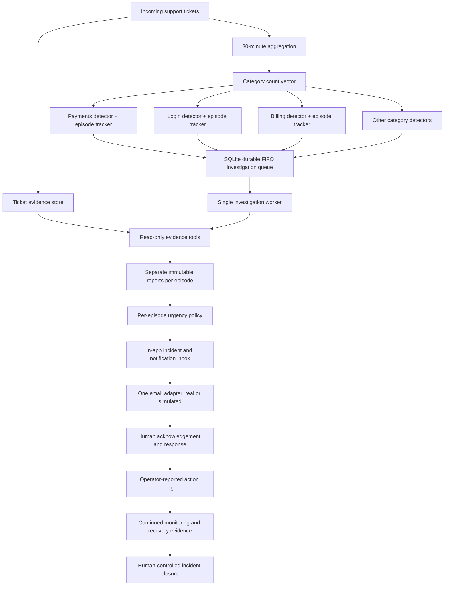

# Agentic Operational Intelligence: End-to-End MVP Implementation Plan

**Status:** Governing end-to-end MVP implementation plan. It freezes scope, sequence, and acceptance gates; it does not claim that all components are implemented.
**Primary use case:** Continuous observation of customer-support ticket volumes, selective investigation, evidence-grounded human notification, and monitoring of incident evolution.
**Initial demonstration:** Payments.
**Multi-category extension:** Independent category processing; cross-category correlation deferred.

This is the main plan for the complete MVP: monitoring and detection, episode creation, queued investigation, evidence-bounded findings, urgency and notification, acknowledgement, human-reported actions, recovery observations, and authorized incident closure. [Investigation Queue and Notification Reliability](investigation-queue-lifecycle.md) is a supporting detail document for the queue and delivery slices. [Design decisions](design_decisions.md) is the concise decision register.

> **Product boundary:** The application autonomously observes, detects, investigates, prioritizes, and brings relevant operational problems to humans. It does **not** autonomously change production systems, notify individual customers, issue refunds, or declare incidents resolved.

---

## 1. Scope and terminology

**Primary persona: Support Operations Lead / Incident Coordinator.** Oversees customer-support trends and coordinates the human response to broader operational problems. Needs to understand what may be happening, its urgency, evidence and uncertainty, which service/team should review it, and whether observations are improving. The coordinator reviews findings, acknowledges notifications, coordinates with engineering, records reported actions, monitors progress, and closes incidents when authorized.

**Secondary personas:**

| Persona | MVP need and responsibility |
|---|---|
| Engineering Responder / Service Owner | Review service-specific evidence, verify technical hypotheses, perform remediation in existing engineering tools, and report outcomes. |
| Frontline Support Agent | See whether a broader issue is known and share observations; individual ticket handling remains in the existing ticketing system. |
| System Administrator / Operations Manager | Configure monitored categories, recipients, backup routing, timeouts, and monitoring policies. A comprehensive administration console is outside the MVP. |

The application is an operational intelligence and incident coordination tool, not a ticket-handling system. It observes ticket activity and operational evidence; it does not replace the source ticketing platform. Support coordinates; engineering responders assess and perform technical remediation in their existing tools.

| Term | Meaning |
|---|---|
| Ticket | An individual customer-support record with creation/availability times, category, and possibly text and metadata |
| Completed window | A fixed, non-overlapping 30-minute interval whose ticket count is ready for detection |
| Window alert | A category's count is flagged as anomalous for one completed window |
| Alert episode | Maximal run of consecutive alerting windows **within one category**, under the current one-quiet-window closing rule |
| Investigation | Evidence-bounded analysis of an episode; may be automatic or manually initiated |
| Investigation report | Immutable result of one investigation with an explicit evidence cutoff |
| Incident workspace | Operator-facing record for an episode, including statistics, reports, notification history, actions, and status |
| Operational incident | Real-world service problem potentially underlying one or more alert episodes; mapping across categories is **not** automated in this MVP |
| Acknowledgement | Human confirms receipt/coordination responsibility; **not** proof of remediation |
| Resolution | Authorized human's recorded decision; **not** implied by a quiet count window |

For the MVP, the relationship is **one new alert episode leads to one incident workspace and one initial investigation**. A later episode receives a new identifier even if it belongs to the same category. Categories are processed independently: no cross-category correlation, deduplication, or joint investigation is included. These are explicit deferred TODOs.

### 1.1 What the statistical detector sees

For category set $\mathcal{C}$ and completed window $k$, define

$$
X_{c,k}=\#\{\text{tickets assigned to category }c
\text{ with event time in window }k\},
\qquad c\in\mathcal{C}.
$$

Here $X_{c,k}$ is a random count before observation; its realized value is $x_{c,k}$. The vector of counts is

$$
\mathbf{X}_k =
\begin{bmatrix}
X_{1,k} & X_{2,k} & \cdots & X_{C,k}
\end{bmatrix}^{\mathsf T}.
$$

**Boldface denotes vectors; uppercase denotes random variables.** The detector receives the realized count vector $\mathbf{x}_k$ (or its category components), window bounds, and category identifiers. **It does not receive ticket text or service logs.** Those are separate evidence sources available to the investigator.

A category-specific detector produces

$$
A_{c,k}=D_c(x_{c,k},\mathcal{H}_{c,k})\in\{0,1\},
$$

where $\mathcal{H}_{c,k}$ denotes the history or model state available to detector $D_c$. This notation abstracts the existing configured statistical method. **The MVP preserves the detector configuration and alerting logic already in the project; this design does not introduce a new detector, threshold change, or statistical benchmarking/calibration project.** The notation does not imply a fixed count threshold, a particular probability model, or independent categories in the real world.


The application should record which existing detector configuration/version produced each alert and retain observed false-alert outcomes when an authorized human identifies them. This is operational traceability, not a new statistical benchmark, calibration exercise, or MVP completion gate.

**Important:** A ticket count is not a count of unique customers. A single customer can create multiple tickets, and ticket volume can change because of reporting behavior.

---

## 2. Single-category flow: Payments

### 2.1 Ticket ingestion and aggregation

1. Incoming support tickets are stored with their category, event timestamp, and available evidence metadata.
2. The aggregation process counts Payments tickets in each non-overlapping 30-minute interval.
3. At the end of each completed window, it emits a `CountObservation`-like record containing the window index, start/end times, and category counts.
4. The detector scores the Payments count. Raw ticket text remains outside the statistical detector.
5. Processing must preserve the distinction between the ticket's **event time** and the time the system **learned of the ticket**. Late-arriving records must not be silently inserted into an earlier frozen investigation.

Example observation:

```json
{
  "window_index": 21,
  "window_start": "2026-11-22T10:00:00+05:30",
  "window_end": "2026-11-22T10:30:00+05:30",
  "category_counts": {"payments": 35}
}
```

The values and timestamps throughout this document are **hypothetical**.

### 2.2 Worked timeline

Assume a typical count of roughly five Payments tickets per window. This is contextual, **not** a universal anomaly threshold.

| Window ending | Payments count | Illustrative detector result | Application behavior |
|---|---:|---|---|
| 09:30 | 4 | Quiet | Continue monitoring |
| 10:00 | 6 | Quiet | Continue monitoring |
| 10:30 | 35 | Alert | Open episode; queue first investigation |
| 11:00 | 42 | Alert | Update same episode's statistics |
| 11:30 | 18 | Alert | Update same episode; note decline |
| 12:00 | 7 | Alert or quiet, depending on model | Apply actual detector decision |
| 12:30 | 5 | Quiet, for this example | End episode if not already ended |
| 13:00 | 4 | Quiet | Routine monitoring continues |

The *alert/quiet* classification comes from the detector, not from eyeballing the counts. The exact end of the episode therefore depends on its outputs.

### 2.3 Episode events and identity

On the **first** flagged window:

- Emit or derive `episode_opened`.
- Assign a stable `episode_id`.
- Create one incident workspace.
- Queue one initial investigation in automatic mode.

On subsequent flagged windows of that same episode:

- Emit or derive `episode_updated`.
- Update start/end, duration, observed count totals, and peak.
- **Do not** enqueue another LLM investigation solely because another window is anomalous.

On the **first quiet window** under the current rule:

- Emit or derive `episode_ended`.
- Finalize episode-level statistics.
- **Do not** equate episode termination with service recovery or incident resolution.

A later alert opens a **new episode ID**, even in the same category.

The currently described runtime emits an `anomaly_alert` for **each** anomalous window and groups those alerts through an episode tracker. The cleaner `episode_opened` / `episode_updated` / `episode_ended` event interface is a **proposed architectural behavior**, not necessarily implemented as such.

Every event needs a stable `event_id`; events for the same episode share an `episode_id`. Duplicate delivery of the *same* event must have no additional effect:

$$
\operatorname{apply}(e,\operatorname{apply}(e,s))
=
\operatorname{apply}(e,s).
$$

This is an idempotency requirement, not an assertion that the implementation already satisfies every failure/retry scenario.

### 2.4 Investigation at 10:30–10:32

The coordinator schedules the initial investigation immediately after the first alert in **automatic mode**. In **manual mode**, the episode appears in the inbox and waits for an operator to start the same investigation workflow.

The investigator can use read-only evidence tools for:

- Relevant customer tickets and their themes.
- Service health and error telemetry.
- Historical incident or issue context.
- Recent deployments and configuration changes.
- Timelines and runbook guidance.

For example, it might find:

| Source | Hypothetical observation |
|---|---|
| Customer tickets | Multiple reports of payment timeouts |
| Gateway health | Timeout rate elevated since 10:08 |
| Change history | Configuration change at 10:05 |
| Runbook | Check gateway health and change configuration |

**Report:** “A payment-processing disruption is plausible. Elevated gateway timeouts corroborate customer reports. The configuration change is temporally associated, but its causal role is unconfirmed. Payments engineering should verify urgently.”

The report must distinguish **observations**, **hypotheses**, **contradictory evidence**, **unknowns**, and **recommended next checks**.

### 2.5 Evidence cutoff and search

Each investigation has a fixed cutoff $t_{\mathrm{cut}}$. A record $r$ is eligible only if it was **available to the system** by that cutoff:

$$
t_{\mathrm{available}}(r)\le t_{\mathrm{cut}}.
$$

A record's event timestamp alone is insufficient. An old issue imported tomorrow cannot be cited in today's already-completed report.

**Agreed principle:** Freeze the cutoff for each report and preserve all earlier report versions.

**Working progressive-search proposal:**

1. Begin with the alert window and the preceding two 30-minute windows.
2. Expand recent ticket and service context to approximately six hours, then at most 24 hours, **if necessary**.
3. Independently retrieve a bounded number of older, still-relevant issues, changes, and runbooks that were available by the cutoff.
4. Search for evidence **against** the leading hypothesis, not just confirming material.
5. Stop when further expansion adds no material evidence, or at configured tool/time/resource limits; report unresolved unknowns.

The MVP search scope is adopted as a bounded operating policy, not a claim that these durations are universally optimal: start with the alert window and two preceding windows; expand recent evidence to six hours and then at most 24 hours only when the current evidence leaves a material question unanswered. Search older persistent issues, changes, and reference material separately by relevance, subject to result/resource limits and the same availability cutoff. Stop earlier when expansion adds no material evidence. A bounded search limits cost and scope; stopping does not prove a hypothesis.

### 2.6 Urgency assessment

**Detection, investigation, and urgency are separate decisions.**

```text
Unusual Payments count
    → episode opened
    → evidence-backed investigation
    → policy-based urgency assessment
    → Immediate / Review soon / Monitor
```

Every incident remains in the inbox. Urgency determines whether humans are interrupted.

| Level | Intended behavior |
|---|---|
| Immediate | Notify responsible team now and request urgent verification |
| Review soon | Prioritize in the inbox for near-term human review |
| Monitor | Keep visible; continue observing |

**Agreed Immediate policy:** At least one of the following must hold:

1. A fresh, trusted operational signal satisfies a predefined high-risk condition (for example, independently monitored payment processing unavailable); **or**
2. Serious, ongoing customer impact is plausible, supported by fresh evidence from **two genuinely different source types**, and delay could worsen the consequences.

The two corroborating source types must also be **distinct in their underlying data and provenance**. Customer tickets and an LLM summary of those same tickets are **not** independent sources. Neither are two dashboards derived from the same underlying ticket feed. Customer reports and independently collected gateway errors can provide distinct corroboration.

**Ticket counts alone do not qualify an incident for Immediate.** Nor does a large anomaly score prove serious customer impact.

The LLM may explain evidence and propose urgency, but **predefined policy controls high-priority notification**. Where serious impact remains unconfirmed, notification wording should be **“Please verify urgently”**, not “Root cause confirmed” or “Rollback required.”

**Implementation detail to validate:** Source freshness, trusted-signal definitions, high-risk conditions, and the mechanism by which evidence is translated into policy inputs. Do not treat a free-form LLM assertion as independent telemetry.

### 2.7 Notification, acknowledgement, and escalation

An incident workspace is created when the episode opens. A notification is created only after the urgency policy qualifies it for human attention. A trusted critical operational signal can qualify for Immediate without waiting for the investigation worker; an urgency decision that depends on investigation evidence is made when that report is ready.

| Time | Event | Recorded behavior |
|---|---|---|
| 10:30 | Payments episode opens | Persist the incident workspace and enqueue its initial investigation |
| 10:32 | Investigation supports Immediate | Create the notification in the in-app inbox; invoke the configured email adapter |
| 10:32 | Email adapter acts | Record dispatch; record delivery only if verifiable. In simulated mode, log `SIMULATED EMAIL` and mark the mode as `SIMULATED` |
| 10:35 | Support coordinator acknowledges in the app | Record the responder and time; cancel any pending escalation |
| 10:42 | No acknowledgement has arrived | Send one email escalation to the configured backup; preserve the escalation record |
| 11:00 | Another alerting window | Update episode statistics; **do not enqueue a new investigation solely for the count update** |

If email dispatch fails, the incident and notification remain in the in-app inbox and the failure is recorded. The email is an attention mechanism, not the authoritative incident record. A delivery provider's acceptance is not proof of delivery unless it reports delivery confirmation.

**Acknowledgement is not resolution.** The coordinator may own communication and coordination while payments engineering owns remediation.

The organization configures primary and backup recipients. The app should not invent an owner. Track **created**, **dispatched**, **delivered** (only when verifiable), **acknowledged**, and **escalated** as separate timestamped facts. Dispatch does not prove delivery; delivery does not prove a person read or acknowledged the notification. The in-app incident/notification inbox is the MVP home for this workflow, with one simple delivery adapter and no additional external integrations. If the demo uses simulated delivery, label it clearly as simulated.

**Agreed MVP demo policy:** Use a **configurable 10-minute acknowledgement timeout**. If the notification remains unacknowledged, send **one escalation** to the configured backup team; do not enter an endless reminder/escalation loop. If no backup is configured, show an unresolved escalation warning. If the primary acknowledges after backup escalation, the primary acknowledgement establishes ownership and **supersedes the backup escalation**; preserve both events in the audit trail and notify the backup of the ownership change where supported. This is a demo default, **not** a universal operational SLA.

The MVP uses the in-app incident/notification inbox plus one email adapter. The adapter supports a real email mode and a clearly labeled simulated mode for synthetic replay; the simulated mode sends no email. Configure primary and backup recipients. Distinguish dispatch from verified delivery where the provider exposes that result.

### 2.8 Human response and action log

At 10:35, support operations acknowledges and contacts payments engineering.

At 10:40, an **authorized engineer**, not necessarily the support coordinator, uses the company's usual operational tooling to restore an earlier gateway configuration.

At 10:42, the coordinator records:

> "Payments engineering reported rolling back gateway configuration at 10:40."

Minimal action-log fields:

| Field | Purpose |
|---|---|
| `incident_id` | Attach to correct workspace |
| `action_description` | What was reportedly done |
| `occurred_at` | When action reportedly occurred |
| `recorded_at` | When app received the record |
| `recorded_by` | Who entered it |
| `performed_by` (optional) | Reported performer/team |
| `source_type` | `operator_reported` |
| `reference` (optional) | Link or ticket ID supporting report |

The app **does not perform the rollback**, independently verify it, or infer that it caused later improvement. An operator-reported action and an independently observed service change are distinct records.

### 2.9 Continued monitoring and recovery observations

The detector keeps processing each completed window regardless of investigation or acknowledgement state. Display observed ticket-count trends, available service-health evidence, and human-reported actions with their timestamps and provenance.

The interface may use these **descriptive states**, with the evidence behind each state visible:

| Label | Meaning in the UI |
|---|---|
| Unknown | There is not enough post-alert observation to describe the direction. |
| Ongoing | Available evidence still shows the problem or its signals continuing. |
| Improving | One or more observed measures are moving toward their usual range, though the issue may remain active. |
| Recovery signs | Multiple available observations are consistent with improvement; this is still not confirmation of recovery. |

These labels summarize observed evidence; they are not a recovery classifier and do not use a two-healthy-window rule. A decline does not establish that a reported action caused the change, prove customer-level resolution, trigger another investigation by itself, or close the operational incident. Statistical episode closure, observed service-health trends, and operational incident resolution remain separate.

### 2.10 Follow-up investigation and report versioning

New alert windows **update live incident statistics**, but they do not themselves trigger new LLM runs. The investigation coordinator, not the detector or LLM, decides follow-ups using the existing significance rule:

- Evidence became available **after** the latest report cutoff.
- It is directly linked to the affected category or service.
- It could materially change the leading explanation, supporting or contradictory evidence, scope/timeline, important unknowns, or next verification step.

Possible qualifying events include a relevant issue-status change, relevant deployment/configuration record, meaningful new diagnostic evidence, or significant service-health change. An **operator-requested follow-up** is also supported. Ordinary new tickets, routine log lines, duplicates, small anomaly-score changes, and another alert window do not qualify by themselves.

Operational behavior:

- Automatic mode: qualifying evidence can queue a follow-up, subject to the adopted cooldown and per-episode cap below.
- Manual mode: show "New evidence available"; an operator may request a follow-up even when the automatic cap has been reached.
- Coalesce significant evidence that arrives during the cooldown into one pending follow-up opportunity; use the newest eligible evidence cutoff when that follow-up starts.
- Do not alter the cutoff of an investigation already running. Permit at most one pending later follow-up while one is running.
- Save each completed follow-up as a **new immutable report revision**.
- Show "Last monitoring update" separately from "Last investigated."

**Newly adopted MVP defaults (not previously validated parameters):** a configurable 10-minute cooldown for automatic follow-up runs, measured from completion of the most recent investigation, and at most two automatic follow-up runs per episode, excluding the initial investigation. These pragmatic demo defaults bound repeated work; they are not empirically optimized values or an industry standard. The cooldown and automatic cap do not block a manual follow-up request. The first quiet window finalizes episode statistics/status and **does not itself start a final LLM investigation**. Significant new evidence can still qualify under the existing rule, and an operator can request a manual follow-up.

#### Where the follow-up lives

A follow-up belongs to the existing episode's incident workspace. In manual mode, show new evidence there for operator review. In automatic mode, show the follow-up as queued or running there, then preserve the new report revision alongside earlier reports. A joint investigation across episodes is deferred, not part of normal follow-up behavior.

### 2.11 Human-controlled closure

An authorized human reviews the evidence and confirms whether the operational problem is resolved. The app records:

- Who made the decision and when.
- Stated reason and available supporting evidence.
- Final incident status.
- The preserved detection, investigation, notification, and action history.

The system must not automatically equate `episode_ended`, `Acknowledged`, or an improving monitoring trend with `Resolved`.

---

## 3. Multi-category flow: independent detection and investigation

The MVP architecture can accept multiple categories **without** building cross-category correlation.

Let

$$
\mathcal{C}=
\{\text{Payments},\text{Login},\text{Billing},
\text{Streaming},\text{Account}\}.
$$

For each completed 30-minute window $k$, aggregation produces the count vector $\mathbf{x}_k$. Each component is scored by its own category detector:

$$
a_{c,k}=D_c(x_{c,k},\mathcal{H}_{c,k}),\qquad c\in\mathcal{C}.
$$

**We do not sum all categories into one count for detection.** Different categories may have different typical volumes, variation, and incident characteristics.

### 3.1 Worked multi-category counts

| Window ends | Payments | Login | Billing | Streaming | Account |
|---|---:|---:|---:|---:|---:|
| 09:30 | 5 | 4 | 3 | 7 | 2 |
| 10:00 | 6 | 5 | 2 | 6 | 3 |
| 10:30 | 35 | 7 | 4 | 8 | 3 |
| 11:00 | 42 | 28 | 16 | 7 | 4 |
| 11:30 | 18 | 31 | 19 | 8 | 3 |
| 12:00 | 7 | 12 | 8 | 6 | 2 |
| 12:30 | 5 | 5 | 3 | 7 | 3 |

These counts are hypothetical; the alert labels below are assumed for illustration.

### 3.2 Events and investigations

**10:30:**
- Payments alerts and opens `payments-episode-001`.
- One Payments investigation begins.
- Login, Billing, Streaming, and Account continue routine monitoring.

**11:00:**
- Payments alerts again; its existing episode and live statistics are updated.
- Login alerts for the first time; opens `login-episode-001` and starts its own investigation.
- Billing alerts for the first time; opens `billing-episode-001` and starts its own investigation.
- Streaming and Account remain quiet.

**11:30:**
- Any category still alerting updates **its own** episode.
- No category gets another investigation just because counts remain high.

The initial investigations are **separate jobs with separate evidence cutoffs and separate reports**. A Payments investigation may find gateway timeouts, a Login investigation may find identity-provider errors, and a Billing investigation may find delayed confirmations.

### 3.3 What the inbox shows

| Workspace | Category | Example finding | Urgency |
|---|---|---|---|
| `payments-episode-001` | Payments | Gateway timeout evidence | Immediate if policy criteria met |
| `login-episode-001` | Login | Authentication errors; cause uncertain | Review soon, illustratively |
| `billing-episode-001` | Billing | Delayed payment confirmations | Depends on its own evidence |
| — | Streaming | No episode | No incident |
| — | Account | No episode | No incident |

Every workspace retains its own alert history, investigation revisions, urgency, acknowledgement, action log, and closure state.

#### 3.3.1 Primary operator inbox

The landing view is an operational incident inbox, not a customer-ticket queue. It should make monitoring context and items needing human attention immediately distinguishable. For example:

```text
OPERATIONAL OVERVIEW
5 categories monitored     2 active incidents     1 needs acknowledgement

PAYMENTS  | Immediate    Payment processing disruption
           Gateway errors corroborate a ticket spike
           Acknowledge / Open incident

LOGIN     | Review soon   Login complaints increasing
           Investigation complete / Cause uncertain
           Open incident
```

The detailed incident workspace contains the timeline, evidence-backed investigation, urgency rationale, notification lifecycle, human-reported actions, and later monitoring observations. Ticket counts remain useful context; the interface does not turn unrelated categories into one incident.


**Crucial limitation:** We do not automatically infer that Payments and Billing share a root cause because they spiked together. We also do not automatically suppress a Billing notification merely because Payments is already being handled. That would require a reliable shared-incident relationship, which is outside the MVP.

### 3.4 Multi-category processing pipeline



This is a **logical architecture**, not a promise that all boxes are implemented or that the system executes them strictly serially. Monitoring continues in parallel throughout the incident lifecycle.

### 3.5 Multi-category invariants

1. **One category's alert cannot extend another category's episode.**
2. **One episode's investigation cannot silently rewrite another episode's report.**
3. **A common timestamp does not establish a common cause.**
4. **Each episode's notification and acknowledgement state is independent.**
5. **Each episode's recovery evidence and human closure are independently recorded.**
6. **New categories can be added by supplying their count streams, detector configuration, and appropriate evidence/routing metadata.**
7. **Shared-service and cross-category relationships remain explicitly unmodeled for this MVP.**

### 3.6 Deferred TODO: Cross-category correlation

**Not in the MVP.** Later, investigate whether episodes across Payments, Billing, Login, etc., are linked by a shared service, deployment, symptom, or independently corroborated cause.

Future work might introduce a correlation layer that proposes shared operational incidents while preserving underlying category episode IDs, reports, and evidence histories. It must not infer causation from simultaneous count spikes alone.

For now, **independent category incidents are the expected behavior**, including the possibility of duplicate-looking notifications. This is a known trade-off, not a hidden promise of deduplication.

---

## 4. State separation

Avoid a single overloaded `status` field. At minimum, distinguish these independent dimensions:

| Dimension | Example values | Who/what changes it |
|---|---|---|
| Episode state | Open, Ended | Detector / episode tracker |
| Investigation state | Not started, Queued, Running, Completed, Failed | Coordinator / worker |
| Attention level | Immediate, Review soon, Monitor | Urgency policy |
| Notification lifecycle | Created in inbox, Dispatched, Delivered (when verifiable), Acknowledged, Escalated | Separate timestamped policy, adapter, and human events; stages can coexist in history |
| Recovery observations | Latest counts, trends, service-health evidence, reported actions | Monitoring and recorded evidence; descriptive only |
| Operational resolution | Open, Resolved | Authorized human |

An episode can be **Ended**, the notification **Acknowledged**, the latest report **Completed**, and the operational problem still **Open**. This is not contradictory.

The application should distinguish **last observed**, **last investigated**, **last notified**, **last acknowledged**, and **last human action** timestamps.

---

## 5. Events, persistence, and replay safety

Suggested logical events (exact names/schemas subject to implementation):

| Event | Trigger | Expected effect |
|---|---|---|
| `count_window_completed` | Aggregation completes | Score counts |
| `anomaly_alert` | Category flagged in a window | Preserve window alert |
| `episode_opened` | First alert of episode | Create episode/workspace; schedule initial investigation if automatic |
| `episode_updated` | Continued alert | Update counts, duration, peak |
| `episode_ended` | First quiet window | Finalize episode statistics; do not start a final investigation or auto-resolve |
| `investigation_completed` | Report committed | Preserve report revision; evaluate urgency |
| `significant_evidence_available` | Qualifying new evidence | Coordinator evaluates follow-up |
| `notification_created` | Policy creates an inbox item | Persist the notification before delivery |
| `notification_dispatched` | Delivery adapter is invoked | Record dispatch attempt; delivery is separate |
| `notification_delivery_confirmed` | Adapter verifies delivery | Record delivered status with adapter evidence |
| `notification_delivery_failed` | Adapter reports failure | Record failure; retain the incident in the in-app inbox |
| `notification_acknowledged` | Human acknowledges | Record responder and time |
| `notification_escalated` | Timeout passes without acknowledgement | Send one backup escalation and preserve the event |
| `incident_acknowledged` | Human acknowledges | Record ownership/coordination |
| `action_recorded` | Human records an action | Append operator-reported timeline entry |
| `incident_resolved` | Authorized human closes | Record resolution decision |

### 5.1 Investigation execution topology

The MVP uses one durable FIFO investigation queue backed by SQLite and one investigation worker. FIFO means jobs begin in durable enqueue order; the single worker runs at most one investigation at a time. Initial investigations for different episodes remain separate jobs, as do eligible follow-ups. A job carries its stable job ID, episode ID, investigation type, immutable evidence cutoff and sequence bound, attempt count, lease expiry, and fencing token.

Ticket ingestion, window aggregation, detector scoring, episode tracking, and live statistics continue while the worker is busy. Continued alert windows update episode statistics; they do not add investigation jobs by themselves. An eligible follow-up is coalesced according to the follow-up rule and then enters the same FIFO queue.

Queued jobs survive an application restart and resume in FIFO order. A worker claims a job transactionally, records a persisted lease, and increments an attempt/fencing token. An expired running job is eligible for one automatic retry (two attempts total); put the retry at the FIFO tail under the same stable job ID and frozen evidence scope. Retain it for operator review after the second failed or expired attempt. The two-attempt limit is a configurable MVP default, not empirically optimized. Enforce one committed report revision per triggering job and fence writes from workers whose lease expired. A provider request may have completed just before a crash while its result was not committed, so retry may repeat execution and cost: the guarantee is idempotent application state, not exactly-once LLM execution or billing. Expose queue depth and oldest waiting-job age. Ingestion, aggregation, detection, episode updates, notification dispatch, and acknowledgement scheduling remain independent of the investigation worker. This single-worker setup is the MVP starting point, not a permanent concurrency ceiling.

Notifications use a durable outbox and stable notification IDs. Persist the inbox notification and outbox row atomically before delivery, record each attempt, and reuse the ID (and provider idempotency key when supported) on retry. If a send outcome is ambiguous and the provider cannot guarantee deduplication, record uncertainty and require review rather than blindly retrying or claiming exactly-once email delivery. Simulated email is the default for synthetic replay and performs no network email delivery. Real email is opt-in through configuration. Email retries/failures do not hold detector transactions or block ticket ingestion.

Persist the acknowledgement deadline when the notification is created. After restart, retain the original deadline. The escalation scheduler transactionally checks current acknowledgement state before claiming the one backup escalation. If a late primary acknowledgement races with a sent escalation, preserve both events and mark the backup escalation superseded. The notification dispatcher and deadline scheduler must not depend on the investigation worker.

**Design invariants:**

- Stable event IDs and episode IDs.
- Duplicate event delivery must not duplicate incidents, investigations, notifications, or actions.
- Investigation jobs and report revisions are traceable to episode IDs and evidence cutoffs.
- Stable job IDs, leases, bounded retries, and report uniqueness make application state idempotent; external LLM execution is not exactly once.
- Notification outbox attempts and acknowledgement deadlines survive restarts; provider idempotency is used when available, otherwise delivery ambiguity is recorded.
- Retry/restart safety must be tested, including the queued, running, completed, and pre-deadline acknowledgement points.
- Notification attempts, successful delivery (if known), and acknowledgement are separate facts.
- Recovery metrics and incident statistics may evolve without changing completed report text.

---

## 6. End-to-end implementation sequence and completion gates

Implement the whole operator workflow in these stages. Keep the existing detector configuration and investigation reasoning unchanged. Each stage must preserve the earlier stages' behavior and data.

| Stage | Implementation slice | Exit gate |
|---|---|---|
| 1. Persisted event and incident contracts | Keep completed count windows, detector checkpoints, episode events, incident workspace, and initial investigation job consistent in SQLite transactions. Preserve stable event/episode/job identities and evidence cutoffs. | Duplicate event delivery creates one episode, incident, and initial job. Existing count-only detection outputs remain unchanged. |
| 2. Durable investigation execution | Implement one FIFO queue and worker, persisted job states, leases/fencing, bounded retry, FIFO queue metrics, and one committed report revision per job. Keep ingestion, count processing, detection, and episode statistics independent. | Queued work survives restart; expired work follows the retry policy; no duplicate committed report; queue depth and oldest wait are observable. |
| 3. Attention and notification lifecycle | Apply deterministic urgency policy; create the in-app notification and durable email outbox row atomically; default to simulated email with no network call; support explicitly configured real email. Persist delivery attempts and acknowledgement deadline. | Failed or uncertain email never erases the inbox item. Simulated mode sends nothing. Acknowledgement-aware escalation survives restart and sends at most one backup escalation. |
| 4. Operator incident workflow | Present episode statistics, immutable investigation revisions, urgency rationale, notification state, human acknowledgement, human-reported actions, later monitoring observations, and authorized human closure. | Acknowledgement is not closure; reported actions are not verified actions; improving counts do not claim causality or auto-close the incident. |
| 5. End-to-end integration and resilience | Exercise synthetic Payments from completed windows through a report, notification, acknowledgement, action entry, recovery observations, and human closure. Repeat for concurrent independent categories and restart boundaries. | The acceptance scenario below passes with no detector/LLM redesign, no duplicate committed side effects, and no external email in default demo mode. |

### Required restart and race checks

| Checkpoint | Required result |
|---|---|
| Restart while a job is queued | Keep it queued; process it in FIFO order. |
| Restart while a job is running | Honor its persisted lease; after expiry allow one retry (two attempts total), with the same job ID and evidence cutoff. Fence a stale worker from committing. |
| Provider may have completed before local commit | Record possible duplicate execution/cost; prevent duplicate committed report state. |
| Restart after report commit | Keep the committed revision; do not rerun that job. |
| Restart while email is pending | Resume from the durable outbox with the same notification ID; use provider idempotency when available, otherwise preserve delivery uncertainty for review. |
| Restart just before acknowledgement deadline | Preserve the original deadline; do not reset the timer. |
| Acknowledgement arrives before escalation claim | Transactionally observe it and do not escalate. |
| Acknowledgement races with a claimed/sent backup | Preserve both events; late primary acknowledgement supersedes backup ownership. |

### MVP completion criteria

The MVP is complete when the workflow works as one observable system: a completed 30-minute count window can open a category-specific episode and workspace; an eligible job produces a report from its frozen evidence scope; policy-driven urgency can create an inbox notification and safely attempt delivery; the human can acknowledge, record an externally performed action, review later observations, and close the incident when authorized. Counts and detector state keep updating while investigation or email delivery is slow. A quiet window ends the statistical episode only. Multiple categories remain independent. The restart and race checks above pass, and default simulated delivery makes no network email request.

## 7. MVP acceptance scenario

A useful demonstration should replay the following:

1. Ingest synthetic Payments tickets and create completed 30-minute count windows.
2. Show healthy windows and a statistically flagged Payments window.
3. Open exactly one Payments episode and incident workspace on the first alert.
4. Launch one initial investigation; retrieve only cutoff-eligible evidence.
5. Produce a report with findings, evidence, uncertainty, and next checks.
6. Apply deterministic urgency policy; send an Immediate notification only if the defined evidence criteria are satisfied.
7. Record a human acknowledgement; verify that acknowledgement does not resolve the incident.
8. Ingest additional anomalous Payments windows; update counts/peak/duration **without** rerunning the LLM from counts alone.
9. Record a support coordinator's report that engineering performed a rollback; preserve actor, reporter, and timestamps.
10. Show later ticket counts and service health next to that action, without claiming causation.
11. Show a quiet window ending the **episode** but leaving operational resolution independent.
12. Permit authorized human closure with a reason and supporting context.
13. Re-deliver an event and confirm no duplicate side effects.
14. Repeat with simultaneous Payments, Login, and Billing anomalies; verify independent episodes, reports, and notification workflows.
15. Confirm **no automatic cross-category grouping** occurs.

Tests should also cover a manual-investigation mode, insufficient evidence, an unacknowledged urgent notification, late evidence, follow-up report versioning, and an investigator failure/retry.

---

## 8. Decision register

### 8.1 Agreed for the MVP

| Decision | Rule |
|---|---|
| Detection input | Aggregated per-category counts, every completed 30 minutes |
| Detector configuration | Preserve the current calibrated configuration and alerting logic; record its version and observed false-alert outcomes; no new benchmarking/calibration project |
| First alert | Opens an episode immediately; no two-window confirmation |
| Episode grouping | Consecutive anomalous windows within one category |
| Episode end | One quiet window; finalize episode statistics, **no automatic final investigation** |
| Initial investigation | One per episode; automatic or manual mode |
| Investigation execution | Durable SQLite FIFO queue; one worker; lease/fencing; one automatic retry (two attempts total); ingestion and detection continue independently |
| Evidence | Read-only retrieval; frozen availability-time cutoff |
| Report updates | New revisions only; preserve previous reports |
| Follow-up significance | New, relevant, potentially decision-changing evidence or explicit operator request |
| Count-only updates | Change live statistics; do not enqueue investigation |
| Urgency | Separate from detection and investigation |
| Immediate notification | Trusted critical signal **or** plausible serious impact corroborated by two genuinely distinct fresh source types with time-sensitive consequences |
| LLM authority | Explain and recommend; deterministic policy governs urgent notification |
| Notification transport | In-app inbox plus one email adapter; simulated mode is default and makes no network email request; real mode is opt-in |
| Notification lifecycle | Created, dispatched, delivered when verifiable, acknowledged, and escalated are distinct timestamped facts; failed email leaves the in-app record intact |
| Acknowledgement | Human coordination/ownership; not remediation; configurable 10-minute demo timeout, one backup escalation, late primary acknowledgement supersedes backup |
| Action log | Record what happened, when, and who recorded it; preserve reported performer when known; do not execute remediation |
| Recovery | Observe subsequent counts and service health; avoid causal overclaim |
| Closure | Authorized human decides and records resolution |
| Multi-category MVP | Independent category detection, episodes, investigations, and incident workspaces |
| Cross-category correlation | Explicitly deferred TODO |

### 8.2 Candidate defaults and genuinely open implementation choices

| Topic | MVP position | Remaining detail, if any |
|---|---|---|
| Existing detector | Preserve current configuration and logic | No new statistical benchmark or calibration project in this MVP |
| Episode end | First quiet window finalizes episode statistics only | None for MVP |
| Recent evidence lookback | Alert window + two preceding windows; expand to six hours, then 24 hours only when justified | Source-specific query limits and materiality checks |
| Automatic follow-ups | Configurable 10-minute cooldown for automatic follow-ups, measured from the previous investigation completion; maximum two follow-ups per episode, excluding initial investigation; coalesce during cooldown; manual requests bypass cooldown and cap | Values are newly adopted demo defaults and unvalidated |
| Manual follow-ups | Always available to an authorized operator | Authorization mechanics are implementation detail |
| Recovery display | Show observed trends, service-health evidence, and reported actions; no recovery classifier | Exact presentation language |
| Notification transport | In-app inbox plus one email adapter; simulated mode is default and makes no network request; real mode is opt-in | Configure real recipients only for an intentional delivery demonstration; no additional provider integrations |
| Immediate policy inputs | Trusted critical-signal definitions, freshness, source provenance, and service-specific policy configuration | Define configured source inventory and policy values; no free-form LLM-only trigger |
| Acknowledgement | Configurable 10-minute demo timeout, one backup escalation, no retry loop; late primary acknowledgement supersedes backup | Configure recipients and the one adapter's verifiable delivery semantics |
| Cross-category deduplication/correlation | Deferred TODO | No MVP behavior |
| Joint investigation across episodes | Deferred TODO | No MVP behavior |

---

## 9. Scope boundary and implementation reality

**In scope:** Existing count ingestion/aggregation and detector configuration; independent per-category episodes; evidence-bounded investigation and report revisions; Immediate / Review soon / Monitor prioritization; an in-app incident/notification inbox with one email adapter (real or clearly labeled simulated mode); acknowledgement and a single backup escalation; human-reported action logging; descriptive monitoring of counts and service-health evidence; authorized human incident closure.

**Out of scope:** Ticket handling or replacing the source ticketing platform; any new statistical benchmarking/calibration project or detector redesign; a two-healthy-window recovery classifier; automatic final investigation on episode end; automated rollback, service restarts, refunds, or other remediation; individual customer messaging; multiple external notification integrations; automatic cross-category correlation, deduplication, or joint investigations; autonomous incident closure.


**Existing-versus-proposed caution:** This document freezes the MVP product scope; it does not assert every workflow is implemented. The prototype includes category-level count detection, alert episode tracking, a replay-driven evidence store, and read-only investigation tooling. Inbox delivery, notification acknowledgement/escalation, operator action records, follow-up controls, and human-controlled closure remain subject to implementation verification. Do not describe a design target as implemented without a code-level check.

### Product definition

> **Agentic Operational Intelligence** is a continuously running operational observer. It detects statistically unusual support-ticket activity, selectively investigates the available evidence, determines when human attention is warranted under explicit policies, and tracks what humans report doing alongside subsequent operational evidence. It assists human response without autonomously executing remediation or claiming unverified resolution.
