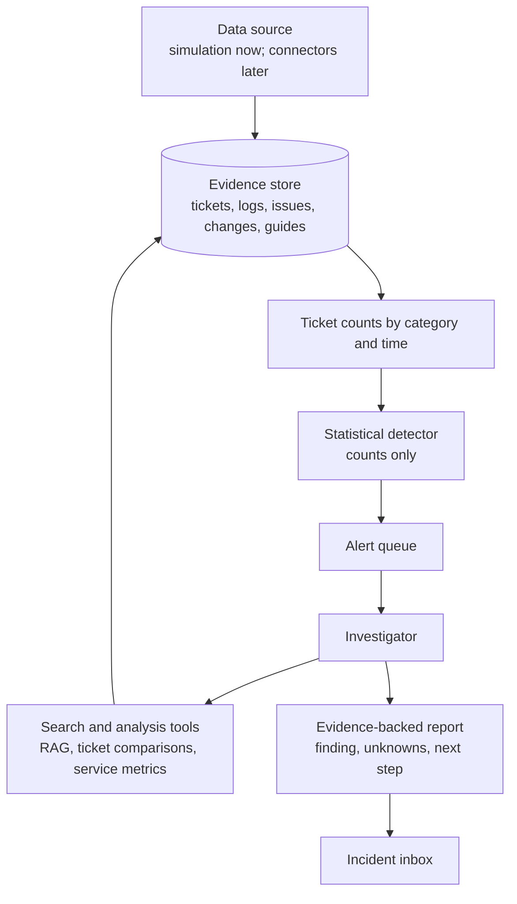
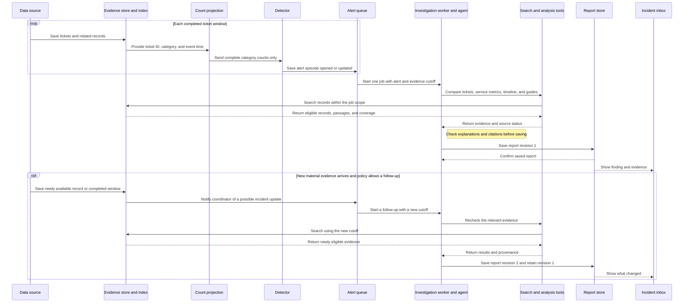

# Proposed architecture: continuous detection and incident investigation

Status: **Design for review. Not implemented.**

Date: 2026-11-21. Baseline reviewed: `feat/alert-retrieval-rca-integration`, commit `abfc431`.

This document proposes the next architecture. The [current integration design](alert-retrieval-rca-integration.md) and [retrieval design](local-hybrid-rag.md) describe the existing implementation. Names, schemas, scheduling rules, and limits below are proposed contracts, not available commands or endpoints.

Suggested first pass: sections 1-4 for the overview, diagrams, and component map; 9-12 for alert handling and investigation; 14 for the operator experience; and 17-18 for implementation order and decisions. The remaining sections specify the integrity and recovery rules needed to make that behavior dependable.

## 1. Product and operating model

The application continuously observes customer contacts, identifies unusual ticket counts, and automatically investigates new alert episodes. An operator opens an incident inbox to see what needs attention, what the investigator found, and what evidence is missing.

The simulator remains useful as a reproducible source of fictional events. Move its controls to a development/replay page. Starting the monitoring service starts its configured source adapter; the operator does not need to generate a new simulation or click Investigate for every episode. With the synthetic adapter, the application must still say that the environment is fictional and show its replay clock. A finite replay ending means the source has ended; it must not silently loop and create duplicate incidents or model charges.

A payment incident occurs in an environment where Orders, Account, and Delivery continue receiving ordinary tickets. Their counts belong in the monitoring overview and in comparisons when useful. The selected Payments incident page should foreground Payments and summarize other categories as comparison evidence. Unchanged categories are useful context, not guaranteed causal controls: their customer populations and normal patterns may differ.

Recommended first operating mode: automatically investigate each new statistical episode, with one investigation worker and explicit resource limits. The operator can request a follow-up or review historical evidence. Automatic investigation produces advice; it does not execute remediation.

## 2. Architecture diagram

This simplified diagram shows the main flow, not a list of services to deploy.

The detector and investigator have separate inputs: the detector gets counts; the investigator gets an alert and can search the stored evidence. The source continues to supply every category, while the incident inbox can focus on the category that alerted and show other categories as context.

For the first implementation, these are modules inside **one backend application and one SQLite database**, not separate services. The evidence store, count detector, alert queue, investigator, and report can all run locally. Durable delivery and recovery still matter, but an outbox and a background worker can be added inside this same application. A message broker, multiple servers, and automatic cross-incident grouping are later options, not prerequisites.

The full sections below describe reliability rules for when the project grows. They should not be read as a requirement to build every box before the first automatic investigation works. Evaluator-only scenario truth remains outside the runtime diagram and is used only in offline checks.

## 3. Sequence diagram: one alert to report

This shows one finalized alert window, the automatic first investigation, and a later report update. The sequence describes the proposed flow; it is not implemented yet.

The count projection passes no message text or service records to the detector. Each investigation uses a fixed cutoff, so a later window cannot appear in revision 1. A later investigation may include that window and preserve the earlier report as revision 1.

## 4. Components at a glance

Each box is a responsibility in the design, not a separate service. In the first version, the application can run these modules in one backend with one local database.

| Component | Purpose |
| --- | --- |
| Data source | Supplies the synthetic replay now and can be replaced by real connectors later. |
| Evidence store and index | Keeps tickets, logs, issues, changes, and guides searchable with their source and time. |
| Count projection | Turns each ticket into one count in its category and time window. |
| Statistical detector | Checks only those counts and emits alert episodes. |
| Alert queue | Saves alerts that need investigation and prevents duplicate jobs. |
| Investigator | Receives one alert job and decides which evidence to examine. |
| Search and analysis tools | Retrieve text, calculate ticket comparisons, inspect service metrics, and build a timeline. |
| Report store | Saves cited findings, unknowns, and next steps as report revisions. |
| Incident inbox | Shows alerts, investigation status, findings, and report history to the operator. |

The text index is part of the evidence-search capability. The alert queue can initially be a database table. Neither requires a separate server for the local project.

## 5. What exists and what changes

| Area | Verified current implementation | Proposed change |
| --- | --- | --- |
| Detection | `CountObservation -> DetectionResult`; count-only module; consecutive category episodes | Keep the statistical rules. Add durable host state, input revisions, explicit episode lifecycle events, and recovery. |
| Runtime | `OperationsRuntime` starts simulation and investigation daemon threads in the API process | Separate monitoring and investigation workers from the API lifetime. |
| Initiation | Operator submits a run-scoped investigation request | Coordinator schedules a new episode automatically; manual requests use the same queue. |
| Persistence | SQLite stores run events, investigation progress, reports, and embeddings | Add source cursors, alert outbox, incident registry, leased jobs, and report revisions. |
| Retrieval | Current-run evidence plus local archive; keyword/vector retrieval and GPU reranking; structured service queries | Make version/snapshot rules explicit, expose source health and coverage, and allow full record inspection. |
| Agent | Six grouped tools, a bounded investigation loop, and report composition | Seven tools; frozen context; explicit alternatives and missing evidence; durable job outcomes. |
| UI | Simulation controls, category charts, episode selection, report and retrieved passages | Incident inbox first; focused incident detail; monitoring overview and replay controls on separate pages. |
| Evaluation | Detector, retrieval, tool, and report checks; synthetic search benchmark | Add automatic delivery, crash recovery, progressive evidence, and end-to-end incident checks. |

The inspected code establishes a useful starting boundary; it does not establish that durable scheduling or snapshot isolation already exists. In particular, source availability filtering must be audited across all new adapters and tools during implementation.

## 6. Ownership and boundaries

| Component | Owns | Must not decide |
| --- | --- | --- |
| Source adapter | Poll/replay cursor, record identity, schema normalization, ingestion availability | Whether a count is anomalous or which cause is true |
| Count projection | Deduplication, window assignment, category counts, completeness | Ticket meaning, log relevance, remediation |
| Statistical engine | Baselines, scores, thresholds, statistical episode continuity | Which documents to search or whether a deployment caused an incident |
| Detector host | Ordered processing, checkpoint/replay, durable alert publication | Evidence-based causal explanations |
| Incident coordinator | Job creation, priority, deduplication, cooldowns, budgets | Inventing a diagnosis or changing detector thresholds |
| Investigation worker | Tool execution policy, model calls, report generation | Reading hidden truth, changing alerts, executing a fix |
| Evidence and retrieval services | Authorized scope, versions, filters, numeric analysis, passage retrieval | Treating a high search score as proof of a cause |
| Report validator | Evidence identity, numeric/source provenance, time scope, schema | Guaranteeing causal correctness merely because citations exist |
| API and UI | Operator requests, persisted status, report display | Running long investigations inside a request or rewriting historical reports |
| Evaluator | Hidden truth, labels, independent metrics | Feeding answers to the investigator |

A service/category map is ordinary reference data, versioned and observable. It must not be derived from a hidden scenario label. Scenario names such as `payment_issue` stay in replay administration and evaluation, outside investigator context.

Store scenario truth in an evaluator-only artifact/database in the proposed architecture. The investigation worker receives no truth-store handle. Its evidence scope includes the current environment and explicitly approved historical reference archives, never another replay's incident records merely because their timestamps overlap.

## 7. Ingestion and count integrity

One customer support interaction remains one ticket. Its title/body supplies investigative evidence; text chunks and later updates to that record do not add tickets. With a future source that models a conversation and replies, define the connector's contact identity explicitly before ingestion. Do not count every reply as a new contact by accident.

Use a source namespace plus stable source record ID and version. Replaying a page from a connector or restarting a replay must upsert/deduplicate that version. Preserve prior versions of issues, changes, and documents so a later resolution or edit cannot rewrite what the system knew earlier.

Count projection receives only ticket ID, category, and event time. The detector receives only finalized counts, window bounds, and the versioned observation identity supplied by its host. Aggregate output must reconcile with the eligible ticket identities in the evidence store. The synthetic generator can still generate counts first, but it must emit exactly that many ticket records and pass reconciliation.

Windows remain 30-minute half-open intervals, for example `[22:00, 22:30)`. A ticket at 22:30 belongs to the next window. Proposed live policy: finalize a window after a short, configurable lateness allowance; two minutes is an initial engineering setting to validate with ingestion data, not a statistically calibrated threshold. The ticket source watermark indicates how far counts are complete. Logs arriving late do not prevent ticket detection.

A missing source interval is **unknown**, not a zero count. The host must withhold or mark incomplete observations rather than invoking a detector with missing categories silently filled as zero. Baseline warmup and data gaps must be visible in monitoring health.

Late tickets after finalization create a revised observation and an audit event. Do not update a historical detector state with the corrected count as if it were a new window. Recompute state from a checkpoint when correction policy requires it, and publish a versioned correction. Previously published reports retain their original inputs. The UI can flag an affected report as based on superseded counts.

An alert correction references the superseded alert events and states whether an episode's bounds changed or its alert was retracted. The coordinator marks the corresponding incident/report scope accordingly; it never erases the original alert or presents a retraction as proof that no service problem existed.

## 8. Core records and identity

These are conceptual schemas. Storage layout can use relational rows with structured payloads; schema versioning is required.

| Record | Required identity and content |
| --- | --- |
| Evidence version | Namespace, source record ID, version, source type, event time, visibility time, ingestion sequence, category/service metadata, payload hash, raw content or durable locator, document section/page when applicable |
| Count observation | Stream ID, window start/end, observation revision, per-category counts, completeness, projection version |
| Detector checkpoint | Stream ID, processed observation cursor, detector configuration version, baseline/cumulative state, active episode state |
| Alert event | Unique event ID, episode ID, episode version, event type, category, window bounds, observed/expected counts, score/threshold snapshot, detector configuration version, emission time, observation reference |
| Incident | Incident ID, namespace, attached episode IDs, statistical activity state, operator lifecycle state, current report pointer, latest evidence/update cursor |
| Investigation job | Job ID, incident ID, reason, pinned episode version, scope/cutoff, evidence/index snapshot, policy version, idempotency key, status, attempts, lease, resource reservation |
| Report revision | Report ID, incident ID, revision, triggering job, immutable scope, finding, competing explanations, citations, coverage, unknowns, next step, model/tool/index versions, resource usage |

Episode IDs must include stream/namespace identity. A category and window index alone can collide across replays. An incident initially maps to one statistical episode. Later correlation can link incidents without deleting their original episodes or reports.

Separate job execution status (`queued`, `running`, `retry_wait`, `completed`, `blocked`, `failed`, `cancelled`) from investigative outcome (`supported_explanation`, `insufficient_evidence`, `partial`). A successful execution can correctly conclude that no cause is supported.

## 9. Alert delivery and durable scheduling

Emit `episode_opened` on the first alerting window. Subsequent consecutive alerting windows emit `episode_updated`; the first known non-alerting window emits `episode_ended`. A data gap does not prove an episode ended. An episode ending only describes statistical continuity; service recovery needs separate evidence or an operator decision.

The detector host writes its next checkpoint, detection result, and pending alert event in one local transaction. If that transaction fails, reconstruct the engine from the committed checkpoint before retrying. If source ingestion already committed, its observation remains available for replay. The pure detector has no database dependency.

The outbox is a durable list of unpublished alert events in the application database. The coordinator consumes it and, in one transaction, creates/updates the incident and job and marks the event delivered. Unique event and job keys make duplicate delivery harmless. An external message broker is not required for the first local version.

| Trigger | Default scheduling action |
| --- | --- |
| New episode | Create an incident and queue its initial investigation immediately. Do not wait for the episode to finish. |
| Episode extends | Update the incident's observed scope. Coalesce updates into at most one pending follow-up. |
| Material new evidence | Request a follow-up, subject to cooldown and budget. Record what changed. |
| Identical alert delivery or repeated button request | Return the existing job for the same idempotency key. |
| Episode ends | Update statistical status. Consider one final follow-up when new evidence or an unresolved question warrants it. |
| Operator requests another investigation | Create a new revision request with an explicit reason and current cutoff; preserve the prior report. |

The initial job retains the first-alert snapshot even if the replay finishes while it waits. Do not silently replace it with the final episode. Pending follow-up jobs can coalesce to the latest eligible snapshot until claimed; record that decision. A running job's context never changes.

Proposed refresh policy: no more than one automatic follow-up per incident per counting window; require new eligible evidence or a changed signal. A high-priority escalation can bypass the cooldown once for that escalation version. Once an episode has ended, keep it eligible for automatic evidence updates for a bounded watch period (proposed: 24 source-clock hours); later reviews are manual. These values need evaluation, not statistical tuning of the detector.

Examples of material evidence are a newly visible issue linked to the affected service, a new failed-request trace, or a newly completed service-metric window. Generic document updates do not automatically re-investigate every incident. Matching uses explicit service/entity references and incident time ranges, with uncertain correlations left for review.

## 10. One incident, queue batches, and shared causes

Start with **one incident per investigation job and one running job**. A burst of 20 alerts becomes 20 durable records; the worker drains the queue by priority and age. Queue batching is an operational scheduling choice, not permission to mix unrelated incidents in one prompt. Rate limits and concurrency caps prevent a burst from creating 20 simultaneous provider requests.

Use a configured priority based on observed excess, persistence, and service importance. Label it investigation priority, not probability of failure. Age waiting jobs so low-priority incidents do not starve. Expose backlog size and oldest waiting age.

Later, add a correlation pass that proposes related incidents using overlapping intervals and a versioned dependency map. Temporal proximity alone cannot establish a common cause. A joint investigation must support each category with its own evidence and retain alternatives. Initially, show related incidents and investigate them independently. This is easier to audit than prematurely merging their histories.

## 11. Time, availability, and report revisions

Every job has an immutable `as_of` cutoff, eligible evidence sequence bound, exact analyzed intervals, baseline interval, episode version, and index generation. Tools receive this context from the server; the model cannot expand its cutoff or select another namespace.

Distinguish when something happened from when the system could know it. In live mode, a record written at 14:00 but first observed by the connector at 14:50 is unavailable to a 14:30 investigation. A later issue edit must not leak its current resolved state into an earlier report.

Replay has a simulated source clock, while the machine records wall-clock execution times. Availability comparisons use one consistent source-clock domain. The replay adapter assigns logical visibility when it releases evidence; historical reference records use declared historical publication/availability dates. Physical database write time is recorded separately. A November laptop run replaying January must never compare those timestamps as if they represented one clock. Preloading future events is permissible only if all reads enforce visibility and the frozen snapshot.

For live sources, visibility cannot precede connector observation. For replay, it follows the declared release schedule. The frozen ingestion sequence also prevents a record imported later with an older authored date from appearing in an existing job. Unknown publication dates require a declared initial-reference policy or exclusion from historical claims; do not treat unknown dates as universal availability.

The first live report includes T and up to T-2/T-1 when present. It includes T+1 only if that window was complete and visible at the job's cutoff. A subsequent revision can include it. Retrospective investigation can deliberately select a later cutoff, but must be labeled as a historical review using later evidence. An old focus window is not by itself a time-travel investigation.

The focus table is local detail around the selected window. The episode summary covers all episode windows known at that revision. Longer pre-incident history and earlier issues are additional context. Tools and reports must label which scope supports a number or claim. Use both start and end times for detector evidence; a result for a normal window should be labeled a count observation, not an alert.

### Worked example: first alert and later evidence

| Source-clock time | Event | System behavior |
| --- | --- | --- |
| 22:00 | Authorization errors begin; customer complaints follow | Evidence is ingested; no causal label is sent to detection. |
| 22:32 | The 22:00-22:30 window finalizes: 30 tickets against about 4 expected; existing detector alerts | Persist an opened episode and queue revision 1. Its focus group contains the two earlier windows and the completed alert window. |
| 22:36 | The worker finishes revision 1 | Report the likely payment symptom, supporting service evidence, missing diagnostics, and exact 22:32 availability cutoff. |
| 22:50 | A new payment issue becomes visible | Queue a follow-up if policy permits. Revision 1 remains unchanged. |
| 23:02 | The next window finalizes: 38 tickets; the episode continues | Coalesce a pending follow-up or request the next one under cooldown policy. The next report can compare both alert windows. |
| Later | A window is no longer alerting | Mark the statistical episode ended. Do not declare the service recovered solely from this. |

The example numbers illustrate lifecycle behavior; they do not recalibrate alert thresholds. Accelerating replay must not change evidence eligible for revision 1, although actual job completion uses wall-clock time.

## 12. Investigator workflow and seven tools

Keep one investigating agent with a constrained report-composition step. Its initial context contains the count signal, exact scope, evidence cutoff, service/category reference map, and available source health. It contains no planted cause or scenario name.

The worker first computes the deterministic incident summary and verifies that required sources can be read. The agent inspects customer complaints and service behavior, forms plausible explanations, and searches for evidence that distinguishes them. A fixed coverage checklist ensures important evidence is considered; targeted follow-ups provide adaptivity. Checklist completion measures coverage, not reasoning quality.

| Tool | Main inputs under server-owned scope | Output and intended use |
| --- | --- | --- |
| `analyze_customer_tickets` | Category; episode or focus scope; baseline choice from allowed intervals | Counts by observed reason/theme/channel, baseline comparison, examples, coverage, unclassified share. Finds what changed in complaints. |
| `query_service_health` | Allowed service/dependency; allowed interval | Structured request/error totals, rates with denominators, time buckets, missing intervals, linked log records. Checks service degradation without vector-searching numbers. |
| `compare_incident_context` | Incident category and approved comparison categories | Before/after counts and other-category comparisons. Checks whether the change is localized. |
| `build_incident_timeline` | Relevant services/entities and allowed context range | Ordered observable events with event and availability times, provenance, and missing coverage. Checks which changes preceded which symptoms. |
| `search_evidence` | Specific query; source groups; bounded category/service filters | Ranked ticket, issue, change, runbook, and guide passages, with source/version/location and retrieval metadata. Finds evidence or competing explanations. |
| `read_evidence` **(new)** | Evidence handles already returned; bounded neighboring-section request | Full eligible record version or document section and limited neighboring context. Lets the agent inspect qualification or exceptions beyond a search excerpt. |
| `get_runbook_guidance` | Previously inspected evidence handles and candidate failure type | Applicable runbook version, prerequisites, advisory action, verification, contraindications, or insufficient-evidence result. Supports a next step. |

The additional read tool has a distinct purpose: retrieving a promising paragraph is not the same as reading the condition that makes its recommendation applicable. It cannot open arbitrary filesystem paths or URLs. Every expansion is scoped, size-limited, and added to the evidence ledger.

Tool results share an envelope: `status` (`ok`, `empty`, `partial`, `unavailable`), query/scope, rows or aggregates, coverage, citations, source health, truncation, and elapsed time. An analytical tool returning a computed comparison must not appear in the UI as "no matching records" because it lacks a flat list. Failures must remain failures, not fabricated zero counts.

Current theme comparisons use observable synthetic reason fields. They are not proof that semantic themes were discovered from free text. Preserve that distinction as `theme_origin`. A later text-theme component may classify or cluster ticket text, with examples and an unclassified group, but it must not receive the simulator's latent cause. Compute prevalence from the full eligible set or a documented representative sample; similarity-search results cannot estimate prevalence because they deliberately favor matching text.

Require tickets, service metrics, context comparison, timeline, and a relevant reference search when available. Runbook guidance is attempted after evidence is collected, and may return no applicable action. Use `read_evidence` whenever the explanation or recommended action relies on a document passage. Explicitly record unavailable sources and skipped checks.

Maintain a small hypothesis table, for example gateway degradation, checkout regression, demand increase, and unexplained count variation. Each entry records support, contradictions, missing discriminating evidence, and the next useful query. Do not force a fixed number of alternatives or invent evidence for them. Stop when a supported explanation and bounded next step are available, no useful query remains, or the budget is exhausted.

## 13. Retrieval and indexing

Preserve the existing local keyword/vector search and GPU reranker. Indexing is separate from incident reasoning: new or changed text becomes versioned passages, while the investigator queries a pinned eligible generation. The evidence store remains authoritative; the vector index is a rebuildable projection.

1. Normalize source metadata, retain record version and content hash, and record publication/visibility.
2. Keep a short ticket or issue update together when it fits. Split long guides at section boundaries and long PDF text into bounded passages with page locations. Preserve heading context and parent-document identity.
3. Embed changed text on the local GPU, index words and vectors, and atomically publish a generation whose manifest matches its metadata and vector files.
4. At query time, restrict namespace, source, version, visibility, and service/category scope. Structured telemetry is queried directly.
5. Retrieve lexical and semantic candidates, combine their ranks, deduplicate repeated/overlapping passages, and rerank a bounded candidate set.
6. Return a small set of diverse passages with provenance. Inspect full records through `read_evidence` when a passage is used in a claim.

Approximate vector filtering can lose useful candidates if many nearest neighbors are ineligible. Overfetch within a limit and retain a filtered lexical route; measure recall after filtering. Do not send ineligible passages to reranking or to the model. The final time/scope check is mandatory even if candidate generation already applies filters.

Keep current incident material and historical reference material distinguishable in results. A useful precedent suggests a hypothesis; it cannot prove that the same cause occurred today. A guide describing a service dependency supplies architectural context; current logs or records must establish whether that dependency actually failed.

When a generation is pinned, its model, chunker, content versions, and metadata remain readable for the job. Store returned excerpts and hashes with the report so later index replacement does not break citations. Offline rebuilds should not consume the live worker's GPU concurrently in the first version. Live incremental indexing can run as bounded work between investigations; expose index lag rather than pretending fresh records are already embedded.

New structured records remain available to exact filtering immediately. If semantic indexing lags or the GPU fails, a declared lexical/structured fallback may still retrieve eligible records. Mark the retrieval mode and coverage as degraded. If no trustworthy path is available, return `unavailable`; do not report "no matches". Startup readiness should identify missing packages/models/index files before the first paid investigation.

## 14. Report contract and operator experience

Each revision answers: what changed, what most likely explains it, why that explanation is supported, what remains unknown, and what to do next. It also records the exact time scope and evidence availability cutoff.

| Report element | Content |
| --- | --- |
| Scope | Episode bounds known at this revision, analyzed focus windows, baseline, availability cutoff, live versus historical review |
| Finding | Short supported explanation or explicit insufficient-evidence statement; distinguish immediate customer symptom from underlying technical cause |
| Competing explanations | Supporting and contradicting evidence, unresolved discriminator, qualitative assessment with a reason |
| Evidence | Stable handles to immutable versions, source titles, time intervals, excerpts, locations, and which claim each supports |
| Retrieval record | Queries, sources searched, passages inspected, passages cited, ranking metadata, unavailable sources |
| Coverage | Missing logs/windows, incomplete counts, sample size, index lag, and which conclusions these limit |
| Next step | Action proposal, prerequisites, responsible service/team if known, verification, runbook citation; no execution |
| Revision changes | New evidence since the previous report and what conclusion changed, including a retracted earlier claim |
| Audit | Job/attempt, detector version, model/prompt/tool/index versions, latency, model calls, tokens and cost estimate |

Validation rejects unknown or out-of-scope evidence handles and checks reported numeric summaries against tool outputs. Citation existence alone does not establish entailment. Report composition must check whether each cited passage supports the claim; evaluation includes human review of that support. Use qualitative assessments until confidence has an independent calibration procedure. Search similarity and reranker scores are not causal probabilities.

The proposed UI has four surfaces:

- **Incident inbox:** category/service, first and latest alert times, observed/expected counts, investigation status, one-line finding, latest report age. Separate "investigating", "waiting", "needs evidence", and "source unavailable".
- **Incident detail:** selected incident, concise finding, next step, exact windows, related evidence and guides, report revision history. Other categories appear as relevant comparison context. Tool traces and numeric retrieval details are expandable.
- **Monitoring overview:** counts for all observed categories, feed freshness, baseline readiness, and statistical alert state. Selecting a category filters the view without stopping monitoring of the others.
- **Replay and evaluation:** fictional scenario, seed, speed, pause/step controls, and evaluation results. These controls do not occupy the normal incident workflow.

The retrieval panel should distinguish **retrieved**, **inspected**, and **cited**. Merely displaying a returned guide does not show that it influenced the diagnosis. A saved report displays historical source health from its execution; current system readiness belongs in a separate indicator. Repairing search does not rewrite an old report.

### Proposed API surface

These paths describe the intended public contract; they are not implemented endpoints. The UI communicates with the application API, which persists requests for workers. The browser never calls the model provider directly.

| Operation | Proposed interface and behavior |
| --- | --- |
| Browse incidents | `GET /api/incidents` with category, status, and cursor filters; return current report pointers and queue state. |
| Inspect incident | `GET /api/incidents/{id}` with known episode scope, revisions, related incidents, and source coverage. |
| Read a report | `GET /api/incidents/{id}/reports/{revision}` returns the immutable saved result without a model call. |
| Request a follow-up | `POST /api/incidents/{id}/investigations` accepts a reason and idempotency key; server pins the allowed context and returns a job reference. |
| Inspect/cancel a job | Job status and a cancellation request; cancellation prevents future work but cannot guarantee reversal of a provider call already submitted. |
| Watch activity | `GET /api/activity/stream` supports a durable event cursor and reconnect; incident updates continue after a replay has ended. |
| Inspect system health | Separate liveness from readiness: source feed, detector warmup/checkpoint, queue/worker heartbeat, provider configuration, GPU models, and index generation. |
| Control replay | Existing run/control operations remain on the development page; they target the source adapter rather than owning the investigation lifecycle. |

All mutation requests record who or what initiated them. Pagination, response size, and stream reconnect cursors are bounded. Existing run/report URLs remain supported during migration and resolve to their historical records.

## 15. Reliability, resource limits, and deployment

Start on the existing machine with three long-running Python roles: API, monitor/coordinator, and investigation worker. Serve the existing web application separately. The replay adapter runs under the monitoring role; offline corpus/index building is an explicit maintenance job. These are independently restartable processes with logical modules, not a requirement for separate network microservices.

Use the existing local database initially for transactions, the outbox, jobs, and reports. Keep transactions short; never hold one while calling the model or running GPU inference. A future database/broker migration should be driven by measured lock contention, ingestion volume, queue latency, or multiple hosts. Keep storage and job interfaces explicit so that migration does not change detector or tool contracts.

The investigation worker retains the embedding and reranking models in memory and processes one job at a time. It claims a job with a time-limited lease and renews it independently of model latency. A monotonically increasing attempt token fences writes from an old worker whose lease expired. Publish a report and complete its job atomically. A unique job/revision identity prevents duplicate visible reports.

Delivery is at least once. Repeated delivery or a crash may repeat a provider call; exactly-once model billing is not promised. Persist completed tool results and call usage where possible, reuse safe results within the same frozen context, and do not retry an ambiguous paid call blindly. An operator-visible partial report is preferable when the remaining budget cannot safely support another attempt.

Proposed initial limits, configurable and to be validated during implementation:

| Limit | Starting policy |
| --- | --- |
| Concurrent investigations | 1 on the local GPU machine |
| Tool invocations | 16 total per single-incident revision; at most 5 per tool; duplicate requests use cached results |
| Model requests | At most 12 across reasoning and report composition; reserve capacity for the final report |
| Job execution time | 3 minutes after worker readiness; timeouts produce a persisted partial/failed outcome |
| Tool output size | Bounded by record count and token allowance; preserve truncation and coverage metadata |
| Retry policy | At most 2 retries for transient failures, with backoff; setup/auth/schema failures block until repaired |
| Follow-up frequency | At most once per counting window unless a new priority escalation justifies one bypass |
| Spending policy | Explicit per-job token limits and a configured daily allowance for live automatic mode; estimates reconciled with reported usage |

These are proposed orchestration limits, not claims about current defaults or measured optimal values. Current code uses a larger total tool ceiling. Account for all model requests including composition and application-level retries; avoid unobserved retries bypassing the budget. Currency estimates are not a hard provider-side billing cap. Reserve a bounded next call before dispatch and stop new jobs when the local allowance is exhausted.

Automatic mode is configured once for the environment. Normal incident handling should not require a new permission dialog for every call. An offline deterministic worker supports unlimited local replay without live model requests. Changing mode, policy, or budget creates an auditable configuration version.

| Failure | Required behavior |
| --- | --- |
| API restarts | Monitoring and active worker jobs continue; UI reconnects to persisted state. |
| Detector host restarts | Restore committed checkpoint and resume ordered observations without duplicate episodes. |
| Worker crashes | Lease expires; eligible job retries under a new fenced attempt; preserve prior results and usage. |
| GPU package/model missing | Mark search readiness unavailable with an actionable setup message; use a declared fallback or block jobs according to policy. |
| No matching reference | Record a successful empty search; continue with available incident evidence. |
| Provider unavailable or allowance exhausted | Preserve queued work, mark wait/block reason, and keep detection running. |
| Source stops reporting | Mark coverage unknown; do not manufacture zero tickets or healthy service metrics. |
| Index rebuild or incompatible manifest | Keep the last valid pinned generation; do not mix metadata from one generation with vectors from another. |
| Too little evidence | Publish an insufficient-evidence outcome and a specific collection request. |

Local demo scope uses fictional data and a single trusted operator. Before exposing the API or connecting real sources, add authentication and source access enforcement; namespaces alone are not authorization. Retrieved text remains untrusted: it cannot change the job scope, invoke arbitrary tools, or instruct the application to execute commands. Secrets never enter prompts, reports, or committed artifacts.

## 16. Observability and evaluation

Track alert-to-queue latency, queue wait, investigation duration, oldest pending job, source/index freshness, tool status/latency, duplicate deliveries suppressed, expired leases, retries, model usage, and report revisions. Distinguish event time from wall-clock latency in replay. Display counts computed by analytical tools correctly rather than deriving all progress from list length.

Evaluate the components separately, then test the full event flow:

| Layer | Acceptance checks |
| --- | --- |
| Ingestion | Duplicate deliveries do not change counts; one ticket equals one contact; updates and chunks do not add events; missing intervals remain unknown. |
| Detection | Same count sequence gives the same alerts regardless of wording or evidence; restart matches uninterrupted state; correction handling is explicit. Preserve existing thresholds during this milestone. |
| Delivery | Crash between detector persistence and dispatch loses no alert; redelivery produces one incident/job; worker restart produces one published revision. |
| Time isolation | Future issue updates and T+1 records cannot appear in revision 1; late imports cannot enter a frozen snapshot; accelerated replay preserves first-alert scope. |
| Retrieval | Relevant passages survive source/time filters; full-record expansion stays scoped; evidence versions resolve; missing dependencies differ from zero matches. Include hard negatives and queries with no relevant document. |
| Investigation | Payment incident supports the correct symptom; innocent changes are not blamed solely for timing; ambiguous evidence yields uncertainty; historical guides do not become current incident facts. |
| Progressive evidence | A later issue or diagnostic record triggers an eligible follow-up; the report explains what changed; the earlier report remains intact. |
| Operator workflow | Alert appears and investigation completes without clicking Investigate; unaffected categories remain accessible as context; UI clearly shows waiting and degraded states. |
| Budget/recovery | A burst is queued within concurrency limits; retries cannot bypass limits; exhausted allowance preserves detection and queued work. |

Healthy count streams normally produce no incident and therefore no agent call. Do not evaluate agent abstention by secretly injecting an alert into a healthy replay without labeling that as a separate investigation fixture. Evaluate false positive detection separately; use documented false-alert/ambiguous-alert fixtures to test whether the investigator avoids unsupported blame.

Retain healthy, unrelated-change, resolved-issue, delayed-evidence, missing-log, and simultaneous-incident scenarios. Separate calibration data from evaluation data and use multiple seeds. Distinct evidence scenarios can share identical count streams; do not count them as independent statistical exposure. The existing 104-query retrieval result remains a synthetic regression result, not a causal-accuracy result.

Use deterministic worker/model doubles for recovery and orchestration checks. Live evaluations are a separate bounded campaign that saves configuration, seeds, calls, costs, retrieved passages, citations, and outcomes. Measure investigation quality and source usage, not just whether the required tools were invoked.

## 17. Implementation sequence and review gates

| Stage | Deliverable | Exit condition |
| --- | --- | --- |
| 1. Contracts and scope | Versioned alerts, evidence visibility, immutable job context, incident/report schemas, documented migration | A worked first-alert and later-evidence example can be represented without future leakage. |
| 2. Continuous monitoring and delivery | Replay adapter behind ingestion interface; count projection; durable detector host/outbox; incident registry | A replay creates an inbox incident automatically; restart and duplicate-delivery checks pass with no model calls. |
| 3. Durable investigation worker | Queue claim/lease/fencing, deterministic worker, retry and budget policies, immutable reports | Queued work survives API/worker restart, produces one visible revision, and handles a burst. |
| 4. Agent and retrieval integration | Existing investigator moved behind the worker; shared tool envelopes; new read tool; pinned retrieval scope/readiness | One real incident produces cited incident and document evidence; unavailable search and insufficient evidence are explicit. |
| 5. Operator UI | Incident inbox/detail and report history; monitoring and replay pages separated | Operator sees an automatically investigated alert and can inspect why the finding changed. |
| 6. Progressive evidence and evaluation | Coalesced follow-ups, bounded evidence watch, scenario suite, limited live campaign | Later evidence revises a report correctly; competing causes and controls expose false blame; results and limitations are documented. |

Stages should remain reviewable. Avoid a single rewrite of detection, retrieval, UI, and scheduling. Migrate existing run reports as historical reports; do not pretend they were automatically investigated in real time. Retain existing report URLs and show their original scope. Any backfill that requires a new model call creates a new revision explicitly.

## 18. Proposed decisions for review

| Decision | Recommendation | Reason |
| --- | --- | --- |
| Main workflow | Automatic investigation of new episodes; operator reviews results | Removes repeated simulation/investigation button work. |
| Synthetic source | Replay remains behind the same ingestion interface as future connectors | Supports reproducibility while exercising the complete pipeline. |
| First job scope | One incident; evidence frozen at first-alert scheduling | Keeps causal/time attribution inspectable and prevents retrospective leakage. |
| Batch handling | Queue multiple jobs; keep their prompts and reports separate | Absorbs bursts without mixing unrelated causes. |
| Shared causes | Add evidence-supported correlation after the single-incident flow works | Avoids merging unrelated incidents merely because they overlap. |
| Tools | Seven, including a bounded read tool | Adds full-context inspection to existing search and analysis. |
| Runtime | API, monitor/coordinator, one GPU investigation worker | Isolates failures without requiring a distributed platform. |
| Storage | Existing local database plus durable outbox/jobs; versioned search generations | Meets local reliability needs and preserves clear replacement interfaces. |
| Statistical scope | Preserve current calibrated detector behavior | Focuses this milestone on operational integration and investigative quality. |
| Remediation | Advice plus verification and provenance | Keeps operational execution outside this project milestone. |

These recommendations are ready for discussion. The follow-up cooldown, evidence-watch period, concurrency and resource ceilings are engineering defaults to validate, not settled product requirements.

## 19. Interview explanation

> I built a system that observes ticket counts and investigates the alert episodes it emits. The statistical detector only sees counts. Its host persists alerts durably, and a coordinator turns new episodes into queued investigations. A worker freezes what was knowable at that point, compares customer and service evidence, searches versioned reference documents with keyword and vector retrieval, and evaluates competing explanations using bounded read-only tools. Every report has source citations, exact time scope, uncertainty, and an advisory next step. Later evidence creates another report revision. Synthetic replay lets me test the whole lifecycle, including duplicate delivery, missing evidence, and worker failures, without relying on private operational data.

Be ready to explain why counts and text follow different paths; why queue batching differs from joint diagnosis; why a first report cannot use a future window; why high retrieval similarity is not causal confidence; why an outbox and idempotent jobs still cannot guarantee exactly-once provider billing; and which parts have been implemented versus remain proposals.
