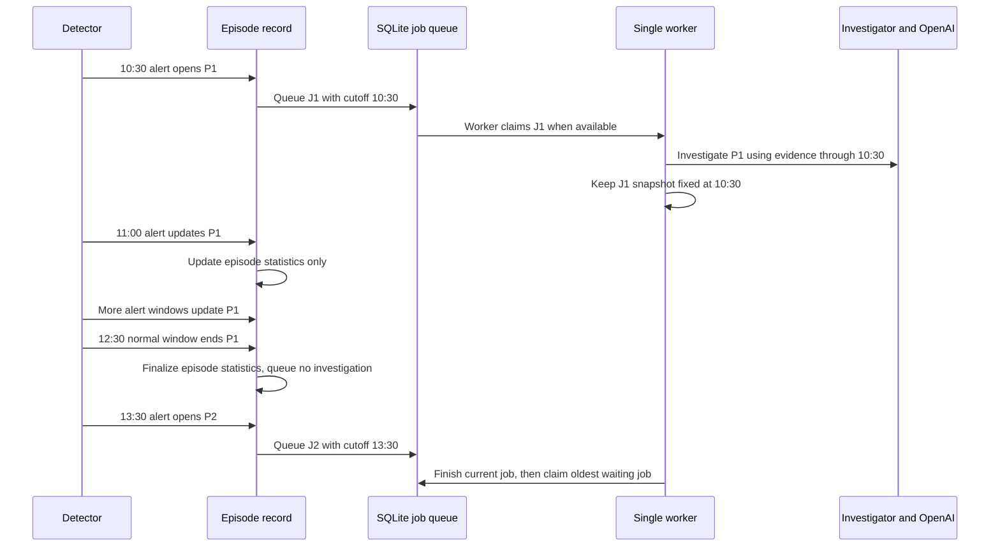

# Investigation Queue and Notification Reliability Details

**Supporting technical detail for the [End-to-End MVP Implementation Plan](agentic_operational_intelligence_end_to_end_design_v2.md).** This document specifies the queue, notification, restart, and race-handling requirements. It is not the overall MVP plan and does not claim that every item is already implemented. Detection thresholds and investigation reasoning are unchanged.

## The five things to keep separate

| Name | Meaning |
|---|---|
| Alert window | One completed 30-minute count window that the detector scores. |
| Episode | Consecutive alerting windows for one category. A normal window ends the episode. |
| Episode event | A saved event that says an episode opened, was updated, or ended. It is not an OpenAI request. |
| Investigation job | A request for the worker to investigate one episode using a fixed evidence cutoff. |
| Worker | The background process that takes queued jobs and runs investigations one at a time. |

The detector processes counts only. Ticket text, service logs, issue records, and changes stay in the evidence store for the investigator to search.

## What an episode contains

The episode is a compact summary of alert continuity. It records:

- category, such as Payments;
- first and latest alerting window;
- number of consecutive alerting windows;
- peak alerting window and its ticket count.

It does not contain every ticket, log, or issue. Those records remain separate and are searched by an investigation. Each episode also has a stable identifier tied to its replay, category, and opening window. Its opening, update, and ending events each have their own event identifier.

An alert window is known only when it closes. For example, the alert for 10:00–10:30 is emitted at 10:30.

## Example: six Payments alerts across four hours

The first four alert windows are consecutive. A one-hour normal period separates them from the last two alerts. A normal window after the last alert closes the second episode.

| Window | Result | Episode state | Queue effect |
|---|---|---|---|
| 10:00–10:30 | Alert 1 | Opens Payments episode P1 | Queue P1 initial investigation, J1, with evidence through 10:30. |
| 10:30–11:00 | Alert 2 | Updates P1 | No new job just because this window alerted. |
| 11:00–11:30 | Alert 3 | Updates P1 | No new job just because this window alerted. |
| 11:30–12:00 | Alert 4 | Updates P1 | No new job just because this window alerted. |
| 12:00–12:30 | Normal | Ends P1 | Finalize episode statistics only; do not queue a final investigation. |
| 12:30–13:00 | Normal | No active Payments episode | No investigation job. |
| 13:00–13:30 | Alert 5 | Opens Payments episode P2 | Queue P2 initial investigation, J2, with evidence through 13:30. |
| 13:30–14:00 | Alert 6 | Updates P2 | No new job just because this window alerted. |
| 14:00–14:30 | Normal | Ends P2 | Finalize episode statistics only; do not queue a final investigation. |

This is **six alert windows, two episodes, and at least two initial jobs**. An eligible significant-evidence follow-up or an operator-requested follow-up may add a job; episode end alone does not. The system does not create six separate investigations.

## When the worker calls OpenAI

The detector does not call OpenAI. When a window closes, the system scores counts, saves the observation and detector result, and writes any episode lifecycle event to a durable SQLite outbox. The coordinator then creates an investigation job for a newly opened episode. This queue handoff happens locally; it is not yet an OpenAI call.

One worker claims the oldest queued job in durable enqueue order, marks it `running`, and starts the investigator. The replay continues while this happens. If the worker is already investigating another job, the new job waits. Queue depth and the age of the oldest waiting job are visible operational measures.



An investigation job freezes the episode snapshot, evidence cutoff, and event sequence available when it was queued. The investigator gets the alert context and read-only tools scoped to that snapshot. Later windows cannot appear in an earlier report. One investigation may involve several OpenAI requests while the agent searches and composes its report.

## What happens if alerts arrive during an investigation?

The episode record is updated as each alert window is processed. An investigation already running is not edited: it continues using its original cutoff. For example, J1 is about P1 through 10:30 even after the 11:00 alert updates P1.

Continued alert windows update statistics and do not queue jobs by themselves. A follow-up may be queued only for qualifying significant new evidence or an operator request, under the existing cooldown and per-episode cap. The first quiet window finalizes episode statistics; it does not trigger an LLM run or close the operational incident.

Consequently, the first report can be older than the episode's current state. In the accelerated replay, several simulated windows can pass while OpenAI is still working: three simulated days play in about two minutes, so one simulated 30-minute window lasts about 0.83 real seconds.

If J1 is still running, the queue could look like this after later episodes and qualifying follow-ups:

```text
Worker: J1 - investigating P1 through 10:30
Queue:  P2 initial investigation -> eligible follow-up for P1
```

The worker finishes J1, then handles the waiting jobs in creation order. Episodes from different categories are separate jobs; the current prototype does not combine them into one diagnosis merely because they occurred close together.

## Frozen MVP reliability requirements

### Durable FIFO investigation jobs

- Use one SQLite-backed FIFO queue and one worker. Jobs from different episodes remain separate; an eligible follow-up enters the same queue.
- Queue order is durable. Persist a stable job ID, episode ID, job reason, immutable evidence cutoff/sequence, state, attempt count, and lease expiry.
- The worker claims a queued job transactionally, records a lease, and increments a fencing/attempt token. A crashed or expired `running` job is eligible for one automatic retry (two attempts total); put the retry at the FIFO tail with the same stable job ID and evidence cutoff. After the second failed/expired attempt, retain it for operator review. Never silently drop it.
- A queued job resumes normally after restart. A running job may have already called the provider before the crash. Retrying can repeat that external execution and cost; exactly-once LLM execution is not promised.
- Stable job IDs and a unique committed-report constraint ensure retries cannot create duplicate committed report revisions for the same job. Preserve the result if it was committed before shutdown.
- Keep ingestion, 30-minute aggregation, detector scoring, episode updates, and statistics independent of the investigation worker. Alert-window updates alone do not enqueue jobs.
- Expose queue depth and oldest waiting-job age. A single worker is the MVP capacity choice, not a permanent concurrency ceiling.

The two-attempt limit is a configurable MVP default, not an empirically optimized value. Lease duration is configured above the expected normal investigation duration and renewed during work. A fencing token prevents a stale worker from committing after its lease was lost. Expose attempts and lease state; do not claim exactly-once provider execution.

### Durable notification delivery and acknowledgement

- The in-app incident/notification inbox is authoritative. Persist the inbox item, stable notification ID, and outbox row atomically before attempting external delivery.
- Use a durable notification outbox and append-only delivery-attempt history. Retry with the same notification ID and provider idempotency key when supported. If a send outcome is ambiguous and the provider cannot guarantee deduplication, record an unknown outcome and require review rather than blindly retrying or claiming exactly-once delivery.
- Configure one email adapter. Simulated email is the default for synthetic replay and must perform no network email delivery. Real email is opt-in through configuration; no other external integrations are part of the MVP.
- Keep notification creation, dispatch attempts, verifiable delivery, failure, acknowledgement, and escalation as distinct facts. Email failure does not remove the inbox record.
- Persist the acknowledgement deadline when the notification is created. Restart must not reset the deadline. The scheduler checks acknowledgement state and claims the one permitted backup escalation in a transaction.
- If acknowledgement and escalation race, preserve event history and apply the ownership rule: a late primary acknowledgement supersedes the backup escalation. Do not send an endless retry or escalation loop.
- Keep notification dispatch and deadline scheduling independent from the investigation worker so a slow LLM run cannot block monitoring or the acknowledgement timer. Email retries/failures must not hold detector transactions or block ticket ingestion.

### Restart acceptance matrix

| Restart point | Expected result after restart |
|---|---|
| Job is queued | It remains queued and is processed in FIFO order. |
| Job is running under a live lease | Do not claim it concurrently; wait for lease expiry or worker recovery. |
| Job lease expires during investigation | Recover under the bounded retry policy; retain the same job ID and evidence cutoff. |
| Both job attempts fail or expire | Keep the job and error history for operator review; do not retry indefinitely. |
| Provider may have completed, but local result was not committed | Record the outcome as uncertain; a retry may repeat provider work, but cannot create a duplicate committed report. |
| Report was committed before restart | Keep the completed report and do not rerun that job. |
| Notification is awaiting email delivery | Resume from its durable outbox state with the same notification ID; retry only when idempotent or known not sent, otherwise record uncertainty for review. |
| App restarts before acknowledgement deadline | Preserve the original deadline and continue the acknowledgement check. |
| Acknowledgement arrives before the scheduler claims escalation | Transactionally observe acknowledgement and do not escalate. |
| Acknowledgement races with an already claimed/sent escalation | Preserve both events; late primary acknowledgement supersedes backup ownership. |

Before MVP completion, test restarts during the Payments scenario while a job is queued, during an investigation, after report completion, and immediately before the acknowledgement deadline. Also test simulated email's no-network guarantee, FIFO order, bounded retries, report uniqueness, notification retry identity, and that monitoring continues while the worker is blocked.

## MVP boundaries and remaining configuration

- FIFO can delay later jobs behind a slow investigation; monitor queue depth and oldest waiting-job age.
- The first report for an episode uses the opening alert's evidence cutoff. A running investigation cannot receive newer alert windows.
- Configure lease duration above the expected investigation duration and renew it during work. The retry policy is fixed for the MVP at one automatic retry (two attempts total), with the configurable limit exposed and exhausted jobs retained for operator review.
- Configure real recipients only when intentionally demonstrating real email. The default synthetic replay uses simulated email and sends nothing externally.
- The replay is synthetic and accelerated; its simulated timestamps are not wall-clock alert intervals.
