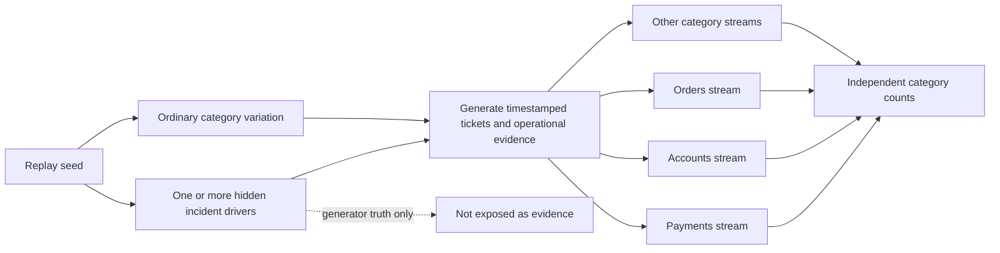
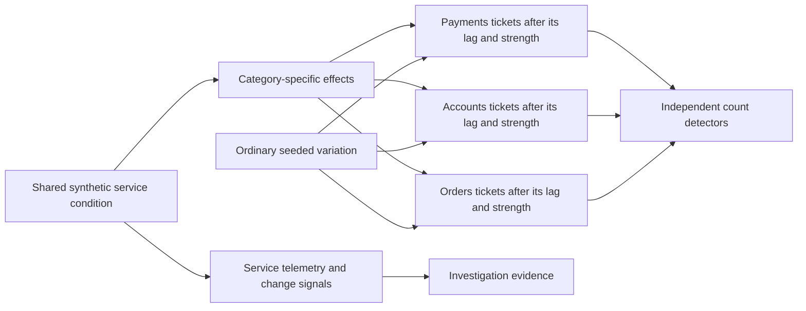
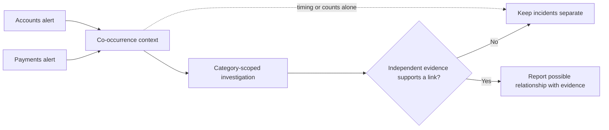
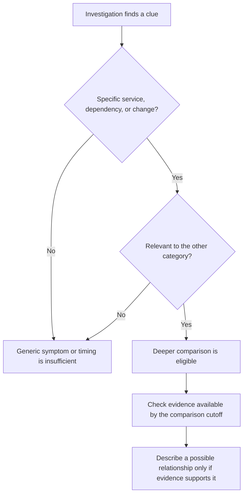
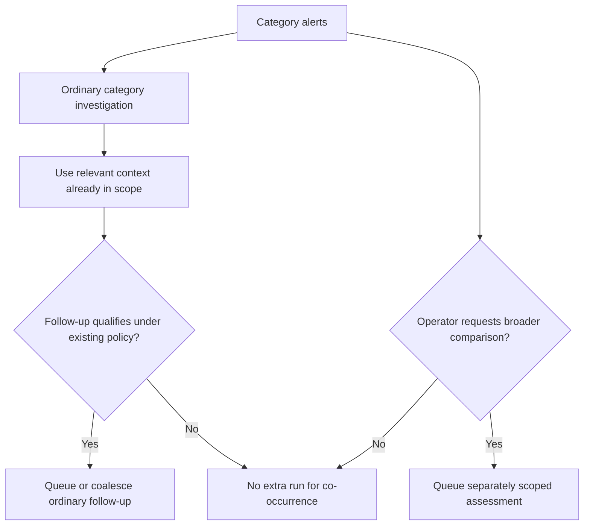
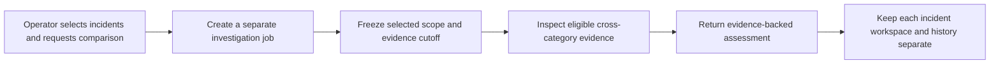
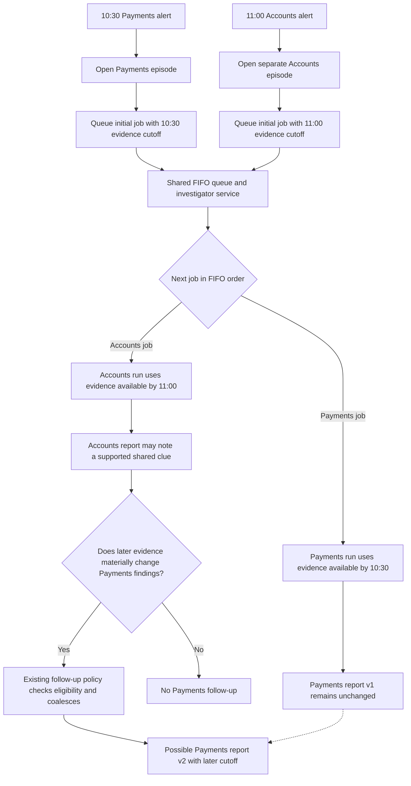
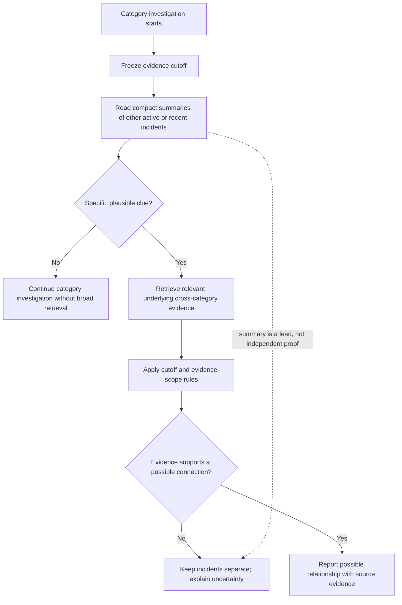
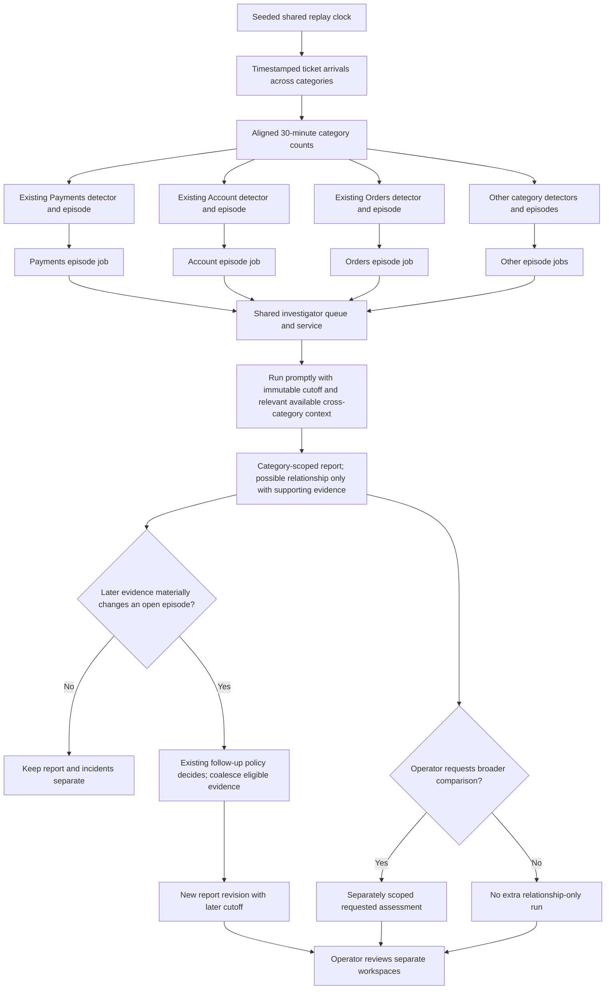

# Multi-category replay scenarios and incident relationships

**Status:** Design in progress. Decisions 1–7 below are agreed; detailed cross-category context and relationship-assessment mechanics remain open. This document does not describe implemented behavior.

**Authority:** The [end-to-end MVP design](agentic_operational_intelligence_end_to_end_design_v2.md) remains the governing product and architecture document. This proposal makes the deferred multi-category scenario and relationship-linking direction concrete; it does not change the MVP scope or decision register.

## 1. Purpose

The current seeded replay demonstrates one category-specific incident at a time. The next replay design should show a system receiving tickets from all monitored categories together, with counts that can rise, fall, or remain ordinary independently over the same timeline. Some scenarios should represent symptoms from a shared operational dependency; others should represent unrelated problems that happen at similar times.

The goal is to make multi-category behavior observable without creating a hand-authored preset for every combination of categories. This design preserves the existing per-category detector and incident lifecycle. It does not introduce joint statistical scoring or a combined incident.

### Agreed decision 1: Reusable seeded incident drivers

Represent a seeded replay using one or more reusable incident drivers over ordinary per-category variation. A driver represents an underlying synthetic condition and specifies which categories it affects, when each effect begins, and how strongly or for how long it affects that category. One driver may therefore create staggered symptoms across several categories; multiple drivers may represent unrelated problems in the same replay.

The seed determines the exact counts, ticket arrival times, and generated evidence. Every category still produces a count for each shared 30-minute window, and its existing detector scores that count independently when the window closes. Scenario-driver identity and intended affected categories are generation-time truth; they are not evidence available to the detector, investigator, or relationship pass.

This decision avoids hand-authoring a preset for every category combination. It does not authorize a joint detector score or merged incident. Each incident keeps its own investigation history, although an investigation may inspect bounded cross-category context available at its evidence cutoff.

### Agreed decision 2: Hybrid service and ticket effects

Use a shared synthetic service condition to generate operational signals and category-specific ticket responses. The service condition evolves over replay time; each affected category responds according to its own lag and strength, with ordinary seeded variation retained in every category. This keeps telemetry, ticket counts, and timing internally coherent while allowing the same underlying condition to affect categories differently.

For example, identity-service latency can rise first, Account complaints can increase in the same or next 30-minute window, and Payments complaints can rise later if checkout depends on that service. The detector still receives only each category's completed ticket count; service signals remain evidence for investigation and possible relationship linking.

This is a synthetic coherence model, not an empirically calibrated prediction of real customer behavior. The exact response curves, effect sizes, and ticket-generation parameters remain open for a later design or implementation-validation step. The replay seed must reproduce the generated counts, ticket arrival times, and evidence.

### Agreed decision 3: Co-occurring alerts do not establish a relationship

Two or more category alerts in nearby windows are **co-occurring alerts**. Their timing and counts alone do not mean that the underlying problems are related. Do not call them correlated or create a relationship link from co-occurrence alone.

Each ordinary category investigation may use relevant, already-available cross-category context within its immutable evidence cutoff. It may report a **Possible relationship** when evidence supports one; nearby alerts or similar counts alone are insufficient. A later alert can inform a new investigation or an eligible follow-up, but cannot change an already completed report. A broader, dedicated relationship assessment beyond the ordinary investigation scope requires an explicit operator request.

### Agreed decision 4: A specific clue, not co-occurrence, supports deeper comparison

One individual investigation finding is enough to make a deeper comparison eligible when it identifies a specific service, dependency, or change that is also relevant to the other incident's category. The comparison checks the other incident's time range and evidence available at its own cutoff. Both individual reports do not need to independently identify the same clue before a comparison can be considered.

A generic symptom such as “timeouts,” a category-count increase, or a nearby alert time does not by itself support a relationship. A specific clue can be included in the relevant category's ordinary investigation context. If it materially changes an existing episode's evidence picture, any automatic follow-up is governed by the already-agreed significant-evidence rule, cooldown, coalescing, and per-episode limit. Eligibility is not a finding: incidents remain separate unless an investigation presents evidence for a possible relationship.

### Agreed decision 5: No extra run solely because alerts co-occur

Co-occurring alerts do not automatically enqueue an extra relationship-only run or make an extra OpenAI call. Cross-category context and relevant clues may be examined as part of an already-scheduled category investigation or a follow-up that qualifies under the existing policy. Surface a possible relationship with its evidence so the operator can review it. A broader, dedicated comparison outside those runs must be explicitly requested by an operator; its exact evidence scope and behavior remain to be designed.

### Agreed decision 6: Operator-requested investigator assessment

When an operator explicitly requests a deeper cross-category comparison beyond the ordinary investigation and eligible follow-up scope, the system may run an investigator assessment of the selected incidents. The job structure, evidence scope and cutoff rules, result format, and number of underlying model/tool calls are intentionally left open until that workflow is designed.

### Agreed decision 7: One shared investigator service; investigate promptly and update with later evidence

Use one shared investigator service and queue for all categories, not a separate investigator agent per category. Keep investigation jobs and report histories scoped to their own category episode. The shared service processes eligible jobs under the queue policy defined by the master design.

Start the initial investigation as soon as a category episode opens and its job is queued. Do not hold a Payments investigation while waiting to see whether Accounts, Orders, or another category alerts. That later alert may never arrive, and waiting would delay a useful first finding.

Each run receives an immutable evidence snapshot and cutoff. It may inspect relevant cross-category incidents and evidence already available by that cutoff. A later category alert opens its own episode and initial investigation; that run can see the earlier category's available context. If later evidence materially changes what is known about an already-open episode, it may be coalesced into an automatic follow-up under the existing significant-evidence, cooldown, and maximum-follow-up policy. No new run is created merely because another category alerted at the same time.

The first report remains a valid account of what was known at its cutoff. Later information can produce a new report revision when a follow-up qualifies; it never silently rewrites the earlier report. One shared investigator service does not mean one combined incident or a single report covering all categories.

#### Proposed default: summary first, then targeted evidence retrieval

Give an investigation a compact index of other active or recent incidents that existed by its evidence cutoff. For each, show the category, relevant alert time range, ticket counts, episode or incident status, and latest available investigation finding. This is discovery context to help the investigator notice a lead; it is not a substitute for the underlying evidence or proof that two incidents are related.

When the context reveals a specific plausible connection, retrieve only the relevant underlying cross-category evidence. Enforce the run's immutable cutoff and applicable evidence-scope rules. Do not fetch every ticket from every category by default. A report summary and the source records behind it are not two independent evidence sources.

For example, the Accounts investigation starting at 11:00 can see a compact summary of the Payments incident and its 10:30 finding. If that points to a shared identity service, it can retrieve relevant identity-service evidence available by 11:00. The Payments run at 10:30 could not see an Accounts alert that had not happened yet.

## 2. Shared replay clock and count windows

All categories use the same replay clock and the same aligned 30-minute windows. Tickets may arrive individually at different simulated times within a window, updating the live ticket sample and current counts. The count for a category becomes a completed observation only when its shared window closes; the existing detector then scores that category using its existing configuration.

For example, an Account issue whose ticket arrivals begin at 10:47 is visible in the live stream during 10:30–11:00. Its completed count is scored at 11:00. A Payments alert at 10:30 does not cause the Account detector to score early or change its window boundaries.

The replay UI should:

- Label the simulated date and UTC window boundaries clearly, separately from the computer's wall-clock time.
- Show all category counts for the same current or most recently completed window.
- Plot category counts as aligned small multiples with a shared time axis. Give each category its own vertical scale so a high-volume category does not flatten lower-volume categories. Preserve the actual count labels and mark completed-window alert results.
- Continue showing the rolling sample of arriving tickets. That sample is illustrative; counts and detector inputs include every released ticket.

### Illustrative synchronized count table

Counts are fictional examples, not thresholds or prescribed detector outputs. `Usual` is shown only as context; each category retains its existing baseline and detector behavior.

| Replay window (UTC) | Payments | Account | Orders | Delivery | Interpretation for the replay |
|---|---:|---:|---:|---:|---|
| 10:00–10:30 | 5 (usual 5) | 4 (usual 4) | 8 (usual 8) | 6 (usual 6) | Ordinary activity |
| 10:30–11:00 | 34 (usual 5) | 4 (usual 4) | 8 (usual 8) | 6 (usual 6) | Payments count rises; its detector scores at 11:00 |
| 11:00–11:30 | 29 (usual 5) | 18 (usual 4) | 9 (usual 8) | 6 (usual 6) | Payments continues; Account count rises and is scored at 11:30 |
| 11:30–12:00 | 20 (usual 5) | 21 (usual 4) | 24 (usual 8) | 7 (usual 6) | Orders count rises and is scored at 12:00 |
| 12:00–12:30 | 8 (usual 5) | 14 (usual 4) | 19 (usual 8) | 6 (usual 6) | Payments may quiet while Account and Orders remain elevated |
| 12:30–13:00 | 5 (usual 5) | 6 (usual 4) | 9 (usual 8) | 6 (usual 6) | Counts move toward their ordinary levels |

Whether any row alerts is determined by the existing category detector. The table does not prescribe alert thresholds, require a particular number of alerting windows, or imply a common cause.

## 3. Reusable seeded scenario patterns

The generator model above is agreed at the product-design level. The precise configuration shape remains open: a driver describes an underlying synthetic condition, its affected categories or services, when its effects begin, and how its effects vary or lag across those categories. Category ticket arrivals and operational evidence are generated from that scenario definition with the run seed. This is not a committed API or database schema.

Use a small set of scenario patterns to cover meaningful behavior rather than enumerating category combinations:

1. **Shared dependency with staggered symptoms:** One synthetic dependency or operational change affects two or more categories at different times or with different strengths. Each category still receives its own tickets, telemetry, detector result, episode, and category-scoped investigation. An investigation may use relevant cross-category evidence available by its cutoff to identify a possible relationship.
2. **Concurrent independent problems:** Two or more categories rise in overlapping windows, but their generated evidence points to different services or changes. They must remain separate and should not be linked merely because their counts move together.
3. **Single-category control:** One category has an incident while the others continue their seeded ordinary variation. Existing category-focused scenarios can continue to serve as controls.

The generator should keep ordinary variation in every category, even during an incident. Scenario truth used to construct the seed is not itself available to the detector, investigator, or relationship review as evidence. Those components see only released tickets and operational evidence available by their replay-time cutoff.

The seven-day replay structure and four-day history preparation followed by a three-day gradual stream remain the current playback convention unless a later design explicitly changes it. Seeds must reproduce the same category counts, ticket ordering, event times, and visible evidence. Do not preload future replay events into the live evidence view before their simulated release time.

## 4. Independent detection and separate incidents

At each shared 30-minute boundary, the existing detector scores each category independently. A category alert opens or updates that category's episode under the existing episode rules. Each newly opened episode queues its own prompt initial investigation through the shared investigator service. Each episode keeps its own incident workspace, job identity, evidence cutoff, report revisions, notification state, action history, and human-controlled resolution. Investigation runs may use relevant cross-category context known at their cutoff, but their primary scope and report remain tied to their episode.

An individual investigation that finds a concrete shared-system clue may include a possible relationship in its category-scoped report. It should consider both:

- Whether the incident time ranges are compatible, allowing a plausible stagger or service-response lag.
- Whether fresh operational evidence available at the investigation cutoff connects the affected services through a shared dependency or change.

Co-occurrence is not sufficient evidence. Ticket counts, two summaries of the same tickets, or knowledge of the hidden scenario driver alone must not establish a relationship. If the review proposes one, show the basis and evidence references so the operator can assess it. **Possible relationship** does not establish a common cause.

An investigation run may retrieve relevant evidence from another category only when that evidence was available by the run's cutoff and is within its defined scope. Later-arriving evidence is available only to a later run. If a broader comparison requires work beyond an ordinary initial investigation or an eligible follow-up, it must be a separately requested run with explicit scope. Each category's initial investigation remains separate, and no run may silently change another incident's lifecycle state.

## 5. Operator presentation

The live monitor presents the shared timeline: synchronized counts for every category, aligned small-multiple charts, completed-window detector status, and the rolling ticket sample. When one or more categories alert, their category and episode status should stand out while the other categories remain visible as monitoring context.

The incident inbox continues to contain incidents created through the existing detection and investigation workflow; a relationship assessment does not invent incidents. Co-occurring alerts may be shown together on the timeline, labeled as co-occurrence rather than a relationship. If an investigation or requested assessment supports a possible relationship, show that label in both workspaces with the time range and evidence basis. Opening either incident still opens its own history and report. The operator can inspect each finding independently and decide how to coordinate the response.

Do not collapse linked incidents into one card that obscures category ownership, combine their counts into a new detector input, suppress either notification, or present the relationship as a confirmed root cause.

## 6. Boundaries and review cases

| Case | Expected design behavior |
|---|---|
| One category rises; others remain ordinary | Only the affected category's detector may open an episode. Other categories stay visible as context. |
| Categories alert in nearby windows | Record co-occurrence as timeline context; do not infer a relationship. |
| An initial investigation is queued for one category | Start it promptly; do not wait for other categories to alert. |
| A category alert arrives while another investigation is running | Queue that category's own investigation; the shared investigator service handles jobs under the master queue policy while monitoring continues. |
| An ordinary investigation has relevant cross-category evidence available by its cutoff | It may use that context and report a possible relationship with evidence; it must preserve its category scope. |
| New evidence materially changes an already-open episode | Apply the existing significant-evidence follow-up policy, including cooldown, coalescing, and per-episode limits; do not create a run solely for co-occurrence. |
| An operator requests a broader cross-category comparison | Run a separately scoped relationship assessment under the eventual request policy. |
| Categories rise at the same time with separate service/change evidence | Keep separate incidents; co-occurrence does not link them. |
| Counts move together but no individual investigation finds a shared-system clue | Keep separate incidents; do not start a relationship review on counts alone. |
| Shared evidence arrives after an investigation cutoff | It cannot alter that report. A later eligible follow-up or operator-requested assessment may consider it under its own evidence-availability cutoff. |
| A linked incident is acknowledged, resolved, or receives an action | Apply the change only to that incident. A relationship does not propagate lifecycle state. |
| A replay is paused or completed | Follow existing replay-clock behavior. Completion means the finite stream ended; it does not mean linked incidents recovered or were resolved. |

## 7. Explicitly out of scope

- Joint multivariate statistical scoring, changing detector thresholds, or recalibrating category detectors.
- Combining incident workspaces, merging episode histories, joint reports that replace category-scoped reports, or deduplicating notifications.
- Inferring causation from time proximity, category co-movement, or seeded scenario truth.
- Automatic remediation, incident resolution, or changes to the existing queue, follow-up, notification, acknowledgement, and closure policies.
- A combinatorial catalog of one preset for every category subset.

These boundaries preserve independent detection and category-scoped incidents while allowing the shared investigator service to use relevant cross-category context. A later proposal may evaluate joint statistical detection or broader joint investigations after the separate incident links and scenario behavior have been reviewed in use.
