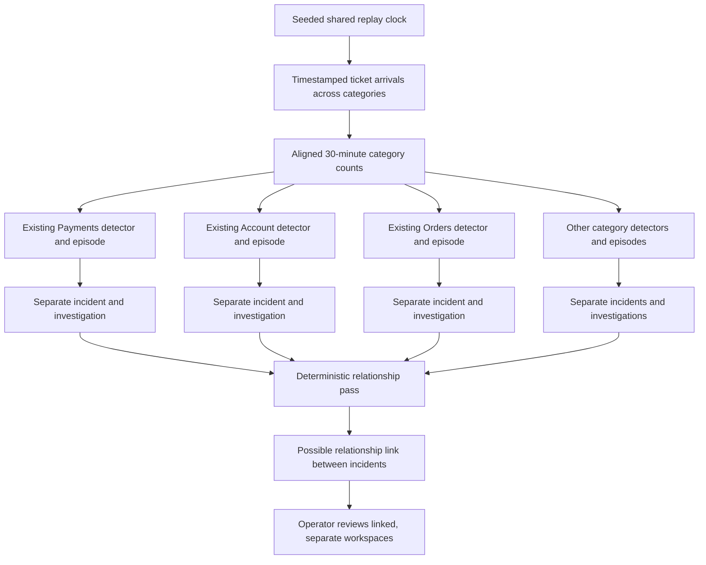

# Multivariate replay scenarios and incident links

**Status:** Proposed design for a future extension. This document does not describe implemented behavior.

**Authority:** The [end-to-end MVP design](agentic_operational_intelligence_end_to_end_design_v2.md) remains the governing product and architecture document. This proposal makes the deferred multi-category scenario and relationship-linking direction concrete; it does not change the MVP scope or decision register.

## 1. Purpose

The current seeded replay demonstrates one category-specific incident at a time. The next replay design should show a system receiving tickets from all monitored categories together, with counts that can rise, fall, or remain ordinary independently over the same timeline. Some scenarios should represent symptoms from a shared operational dependency; others should represent unrelated problems that happen at similar times.

The goal is to make multi-category behavior observable without creating a hand-authored preset for every combination of categories. This design preserves the existing per-category detector and incident lifecycle. It does not introduce joint statistical scoring or a combined incident.

## 2. Shared replay clock and count windows

All categories use the same replay clock and the same aligned 30-minute windows. Tickets may arrive individually at different simulated times within a window, updating the live ticket sample and current counts. The count for a category becomes a completed observation only when its shared window closes; the existing detector then scores that category using its existing configuration.

For example, an Account issue whose ticket arrivals begin at 10:47 is visible in the live stream during 10:30–11:00. Its completed count is scored at 11:00. A Payments alert at 10:30 does not cause the Account detector to score early or change its window boundaries.

The replay UI should:

- Label the simulated date and UTC window boundaries clearly, separately from the computer's wall-clock time.
- Show all category counts for the same current or most recently completed window.
- Plot category counts as aligned small multiples with a shared time axis. Give each category its own vertical scale so a high-volume category does not flatten lower-volume categories. Preserve the actual count labels and mark completed-window alert results.
- Continue showing the rolling sample of arriving tickets. That sample is illustrative; counts and detector inputs include every released ticket.

### Illustrative synchronized count table

Counts are fictional examples, not thresholds or prescribed detector outputs. `Usual` is shown only as context; each category retains its existing baseline and detector behavior.

| Replay window (UTC) | Payments | Account | Orders | Delivery | Interpretation for the replay |
|---|---:|---:|---:|---:|---|
| 10:00–10:30 | 5 (usual 5) | 4 (usual 4) | 8 (usual 8) | 6 (usual 6) | Ordinary activity |
| 10:30–11:00 | 34 (usual 5) | 4 (usual 4) | 8 (usual 8) | 6 (usual 6) | Payments count rises; its detector scores at 11:00 |
| 11:00–11:30 | 29 (usual 5) | 18 (usual 4) | 9 (usual 8) | 6 (usual 6) | Payments continues; Account count rises and is scored at 11:30 |
| 11:30–12:00 | 20 (usual 5) | 21 (usual 4) | 24 (usual 8) | 7 (usual 6) | Orders count rises and is scored at 12:00 |
| 12:00–12:30 | 8 (usual 5) | 14 (usual 4) | 19 (usual 8) | 6 (usual 6) | Payments may quiet while Account and Orders remain elevated |
| 12:30–13:00 | 5 (usual 5) | 6 (usual 4) | 9 (usual 8) | 6 (usual 6) | Counts move toward their ordinary levels |

Whether any row alerts is determined by the existing category detector. The table does not prescribe alert thresholds, require a particular number of alerting windows, or imply a common cause.

## 3. Reusable seeded scenario patterns

Represent a replay as a seeded baseline plus one or more reusable incident drivers. A driver describes an underlying synthetic condition, its affected categories or services, when its effects begin, and how its effects vary or lag across those categories. Category ticket arrivals and operational evidence are then generated from that scenario definition with the run seed. This is a design model, not a committed API or database schema.

Use a small set of scenario patterns to cover meaningful behavior rather than enumerating category combinations:

1. **Shared dependency with staggered symptoms:** One synthetic dependency or operational change affects two or more categories at different times or with different strengths. Each category still receives its own tickets, telemetry, detector result, episode, and investigation. Evidence about the shared dependency provides a basis for a possible relationship.
2. **Concurrent independent problems:** Two or more categories rise in overlapping windows, but their generated evidence points to different services or changes. They must remain separate and should not be linked merely because their counts move together.
3. **Single-category control:** One category has an incident while the others continue their seeded ordinary variation. Existing category-focused scenarios can continue to serve as controls.

The generator should keep ordinary variation in every category, even during an incident. Scenario truth used to construct the seed is not itself available to the detector, correlation pass, or investigator as evidence. Those components see only released tickets and operational evidence available by their replay-time cutoff.

The seven-day replay structure and four-day history preparation followed by a three-day gradual stream remain the current playback convention unless a later design explicitly changes it. Seeds must reproduce the same category counts, ticket ordering, event times, and visible evidence. Do not preload future replay events into the live evidence view before their simulated release time.

## 4. Independent detection and separate incidents

At each shared 30-minute boundary, the existing detector scores each category independently. A category alert opens or updates that category's episode under the existing episode rules. Each episode keeps its own incident workspace, investigation job, evidence cutoff, report revisions, notification state, action history, and human-controlled resolution.

The deterministic relationship pass may propose a link when both conditions hold:

- The incident time ranges are compatible, allowing a scenario's declared stagger or service-response lag.
- Fresh, independently observed operational evidence connects the incidents through a shared service, dependency, or change record.

Timing is necessary context but is not sufficient evidence. Ticket counts, two summaries of the same tickets, or knowledge of the hidden scenario driver alone must not establish a link. Store the basis and evidence references for each proposed relationship so the operator can see why it appeared. A proposal means **possibly related**; it does not establish a common cause.

The relationship pass is deterministic and does not invoke an LLM. Existing per-incident investigation jobs remain separate. The investigator does not receive another category's episode as implicit context through this feature.

## 5. Operator presentation

The live monitor presents the shared timeline: synchronized counts for every category, aligned small-multiple charts, completed-window detector status, and the rolling ticket sample. When one or more categories alert, their category and episode status should stand out while the other categories remain visible as monitoring context.

The incident inbox continues to contain incidents created through the existing detection and investigation workflow; correlation does not invent incidents. If two existing incidents meet the relationship policy, show a **Possibly related** link in both workspaces with the matching time range and shared evidence. Opening either incident still opens its own history and report. The operator can inspect each finding independently and decide how to coordinate the response.

Do not collapse linked incidents into one card that obscures category ownership, combine their counts into a new detector input, suppress either notification, or present the relationship as a confirmed root cause.

## 6. Boundaries and review cases

| Case | Expected design behavior |
|---|---|
| One category rises; others remain ordinary | Only the affected category's detector may open an episode. Other categories stay visible as context. |
| Categories rise in staggered windows and share fresh dependency evidence | Each detector opens its own episode as warranted; the relationship pass may link the separate incidents. |
| Categories rise at the same time with separate service/change evidence | Keep separate incidents; do not link them based on timing or count movement. |
| Counts move together but no shared operational evidence is available | Keep separate incidents and show no relationship link; missing evidence does not prove independence. |
| Shared evidence arrives after an investigation cutoff | It cannot alter that report. A later eligible assessment may consider it under the existing evidence-availability rules. |
| A linked incident is acknowledged, resolved, or receives an action | Apply the change only to that incident. A relationship does not propagate lifecycle state. |
| A replay is paused or completed | Follow existing replay-clock behavior. Completion means the finite stream ended; it does not mean linked incidents recovered or were resolved. |

## 7. Explicitly out of scope

- Joint multivariate statistical scoring, changing detector thresholds, or recalibrating category detectors.
- Combining incident workspaces, merging episode histories, joint investigations, or deduplicating notifications.
- Inferring causation from time proximity, category co-movement, or seeded scenario truth.
- Automatic remediation, incident resolution, or changes to the existing queue, follow-up, notification, acknowledgement, and closure policies.
- A combinatorial catalog of one preset for every category subset.

These boundaries preserve the master design's independent-category MVP. A later proposal may evaluate joint investigations or multivariate detection after the separate incident links and scenario behavior have been reviewed in use.
