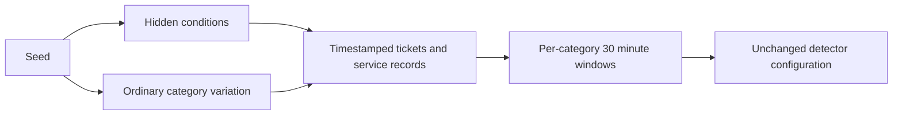

# Stage 1: Mixed-category replay

## Delivered

- Added a seeded **Mixed categories** replay option and made it the default monitor choice. Existing payment, order, account, and delivery profiles remain available.
- Mixed seeds select one to three hidden synthetic conditions with independent timing and lagged effects across two customer-facing categories per condition.
- Generated ticket arrivals and service records reflect each affected category. The detector still receives only completed per-category 30-minute counts.
- Generator condition identifiers and intended category membership are not emitted as evidence.

## Verification

- `uv run pytest tests/test_simulation.py tests/test_demo_profiles.py tests/test_api.py -q`
- Result: 24 passed, 1 cache warning, 2 subtests passed.

## Limits

This stage generates a realistic-looking multi-category stream but does not yet provide cross-category investigation context or relationship findings. Those arrive in later stages. Synthetic relationships are generated from shared conditions but are not automatically asserted by the application.
