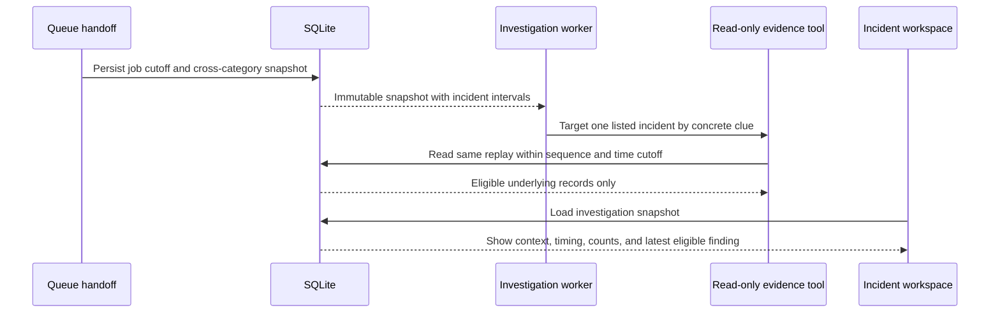

# Stage 2: Immutable cross-category context

## Delivered

- Added an additive SQLite migration that stores a compact cross-category context snapshot on each investigation job.
- At queue time, snapshot only other open incidents from the same replay whose alert windows are within the job's sequence and evidence cutoff. Incidents in the same category and resolved incidents are excluded.
- The investigator receives this context as a navigation index and can retrieve targeted underlying records for a listed incident. Retrieval is constrained by the snapshotted incident interval and the job's existing sequence/time cutoff.
- The incident workspace displays the context considered for each investigation and labels it as context rather than proof of a shared cause.

## Verification

- Focused worker, workspace, and investigator-tool tests cover snapshot filtering, workspace serialization, targeted cross-category evidence bounds, and tool registration.
- The job snapshot is written in the same transaction as the durable queue handoff; retries reuse the stored job and snapshot.

## Limits

This stage makes cross-category context available but does not yet create or display relationship groups. A context summary or co-occurring alerts alone are not treated as evidence of a shared cause.
