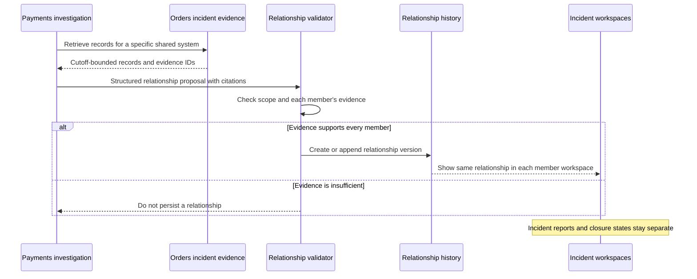

# Stage 3: Evidence-backed relationship groups

## Delivered

- The investigator can propose a relationship between the incident it is investigating and other incidents frozen in the job's cross-category context.
- A relationship requires a specific shared service, dependency, or change, plus underlying evidence retrieved separately for every incident. Alert timing, counts, ticket summaries, and the context index alone do not qualify.
- The report retains relationship status, explanation, member incidents, and supporting evidence references. A deterministic validation pass rejects unsupported or out-of-scope proposals before persistence.
- SQLite stores relationship membership separately from incidents and appends assessment versions. Later investigations can reaffirm, weaken, or withdraw an existing group without rewriting earlier reports.
- Each member incident workspace displays the relationship and its evidence basis. Incident reports and incident lifecycle actions remain independent.

## Verification

- `uv run pytest tests/test_incident_worker.py tests/test_incident_workspace.py tests/test_agent_tools.py -q --tb=short` - 20 passed.
- `npm run build` from `web/` - passed.
- `git diff --check` - passed; Git reports only its normal LF-to-CRLF working-copy notices.

## Limits

- The relationship assessment is part of an existing investigation run; it does not start an extra LLM run by itself.
- No shared incident or cross-category lifecycle is created. The relationship is an evidence-backed view across independent incidents.
- The investigator may leave incidents unlinked when the evidence does not establish a specific common system.
