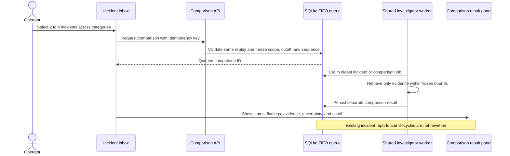

# Stage 5: Requested incident comparison

## Delivered

- Operators can select two to four incidents from different categories in the same replay and request a comparison from the incident inbox.
- The request freezes its selected incident summaries, alert windows, replay evidence cutoff, and event sequence bound. It is idempotent and stored in SQLite.
- Comparison jobs use the same durable FIFO ordering and single investigation worker as incident investigations. Queue status includes both job types.
- The investigator receives the selected category signals and bounded evidence tools. It is asked to compare findings while keeping the category workspaces separate and stating uncertainty.
- Results have their own comparison history and show status, replay cutoff, app completion time, category findings, any supported relationship, evidence, and unresolved questions.
- A comparison result does not create incidents, append an incident report revision, or change incident status, notification state, or lifecycle.

## Verification

- Focused API, worker, detector-host, workspace, and investigator-tool tests passed during implementation.
- `uv run pytest -q --tb=short` - 117 passed, 9 subtests passed.
- `npm run build` from `web/` - passed.
- `git diff --check` - passed.
- The only test warning was pytest's Windows cache-directory `WinError 183`; it did not affect test results.

## Limits

- Comparison is operator-requested; co-occurring alerts do not queue it automatically.
- The initial interface accepts up to four incidents and requires at least two categories, all from one replay.
- The comparison result is informational and does not merge incident workspaces or trigger action, notification, or closure.
