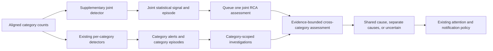
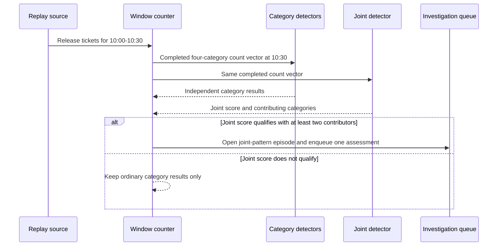
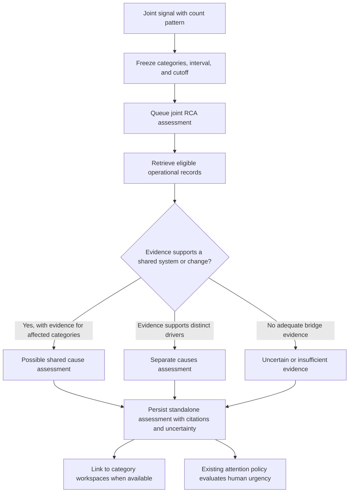

# Joint Count Detector and Cross-Category Assessment Design

**Status:** Proposal for a post-MVP extension. This document describes intended behavior and evaluation; it does not describe implemented functionality.

**Branch:** `feat/joint-count-detector`

**Authority:** The [end-to-end MVP design](../docs/design/agentic_operational_intelligence_end_to_end_design_v2.md) remains the governing MVP contract. That MVP preserves category-by-category detection and defers joint statistical scoring. This proposal explores a separate extension without changing the existing per-category detector, its thresholds, count inputs, or category incident lifecycles.

## 1. Purpose

The current detector asks whether each category's ticket count is unusual by itself. A joint detector would ask a second question:

> Is the observed combination, or recent sequence, of category counts unusual when considered together?

The four monitored categories are Payments, Orders, Account, and Delivery. Their counts are aligned to the same completed 30-minute window. The joint detector consumes only those counts and their existing window boundaries. It does not inspect ticket text, operational evidence, hidden replay truth, or LLM output.

The design covers two statistical scenarios:

1. **Same-window combination:** Two or more categories have an unusual combination of counts in one completed window.
2. **Delayed sequence:** Two or more categories show an unusual pattern across the current window and up to four preceding windows. The earliest contributing window's completion time may be at most two hours before the current window's completion time.

The joint detector emits a statistical signal, not a cause. A separate automatic joint RCA assessment investigates whether evidence supports a shared cause, separate causes, or neither conclusion. Co-occurring counts alone cannot establish a relationship.

## 2. Terminology and responsibility boundaries

| Term | Meaning | Does not mean |
|---|---|---|
| Category alert | Existing detector says one category's count crossed its configured alert rule. | Another category shares its cause. |
| Joint pattern signal | Joint detector says a multi-category count combination or sequence is unusual. | A confirmed incident or root cause. |
| Joint-pattern episode | Consecutive qualifying joint signals grouped as one statistical period. | One combined operational incident. |
| Joint RCA assessment | A separately queued investigator run that examines the pattern and eligible evidence. | Automatic remediation or proof of causality. |
| Possible relationship | Investigator assessment supported by specific evidence relevant to the involved incidents. | A conclusion based only on timing, count co-movement, or replay truth. |

Responsibilities stay separated:



The existing category detectors continue to run independently and retain their current settings. A statistical joint signal may queue one joint RCA run per joint-pattern episode, including when category-specific investigations are already queued. This is intentional: the category jobs answer category-scoped questions; the joint job answers the additional cross-category question. Each qualifying window does not create another job.

A joint signal alone does not create an operational incident, assign Immediate priority, or send a human notification. The investigator's saved assessment is a separate record, linked to relevant category incidents when they exist. It does not merge category workspaces or replace their reports. Existing attention and notification policies apply to any supported finding.

## 3. Count-vector representation and candidate mathematics

Let $t$ index a completed 30-minute window and let $c$ index one of the four categories. The observed count vector is:

$$
\mathbf{Y}_t = (Y_{P,t}, Y_{O,t}, Y_{A,t}, Y_{D,t})
$$

For category $c$, let $\hat{\mu}_{c,t}$ be its expected count for the window and $\hat{v}_{c,t}$ its predictive count variance. The variance must represent ordinary count variation, including over-dispersion when present; it must not automatically be assumed equal to the mean.

A normalized residual is a category-relative description of how far the count is from expectation:

$$
R_{c,t} = \frac{Y_{c,t} - \hat{\mu}_{c,t}}{\sqrt{\hat{v}_{c,t}}}
$$

For an upward-pattern candidate, define $R^+_{c,t}=\max(0,R_{c,t})$. This prevents a low count in one category from being treated as a ticket spike. Normalization makes categories with different usual volumes more comparable. It does not itself establish a statistical threshold or a shared cause.

### 3.1 Candidate same-window score

One candidate is a dependence-aware score over the positive residual vector:

$$
\mathbf{R}^+_t = (R^+_{P,t}, R^+_{O,t}, R^+_{A,t}, R^+_{D,t})
$$

$$
S^{\mathrm{same}}_t = f_0(\mathbf{R}^+_t;\hat{\theta})
$$

Here $f_0$ represents a candidate model of the normal joint behavior, and $\hat{\theta}$ its fitted parameters. A residual-dependence implementation could use a regularized covariance model; an alternative could score the predictive probability of the full count vector directly:

$$
S^{\mathrm{count}}_t = -\log \hat{P}_0(\mathbf{Y}_t \mid \text{normal time context})
$$

These are candidates for offline comparison, not a final algorithm selection. The chosen score must be calibrated as a joint signal over the full vector, not as four unrelated per-category tests.

### 3.2 Candidate delayed-sequence score

At the close of window $t$, evaluate the current vector and the four previous completed observations. Lag $\ell=0$ means the current observation; $\ell=4$ is the observation whose window ended two hours earlier. Thus the five observations have completion times from $t-2\mathrm{h}$ through $t$; their covered window starts can span 2.5 hours because each observation covers a 30-minute window. For category $c$, a candidate lag-aware score is:

$$
S^{\mathrm{lag}}_t =
\max_{\ell_P,\ell_O,\ell_A,\ell_D \in \{0,1,2,3,4\}}
f_{\ell}\left(
R^+_{P,t-\ell_P},R^+_{O,t-\ell_O},
R^+_{A,t-\ell_A},R^+_{D,t-\ell_D};\hat{\theta}
\right)
$$

The evaluated pattern must have at least two distinct contributing categories. The maximum-over-lags search creates more chances for a high score than a single-window test. Offline threshold evaluation must therefore reproduce the complete lag search and calibrate its maximum, rather than treating each lag choice as an independent free test.

This formulation is intentionally conceptual. The offline method comparison will determine whether the first practical score should use residual dependence, a direct joint count model, or a simpler supported alternative. No neural model or causal graph is required for this count-only detection task.

### 3.3 What the score can and cannot say

If Payments and Account normally move together during a predictable busy period, their joint increase may be unsurprising even when both counts are above their usual averages. Conversely, moderate increases in both may form a rare combination if those categories normally vary independently. The joint score tests surprise relative to the learned normal pattern; it does not identify why the pattern occurred.

## 4. Scenario A: Same-window multi-category pattern

### 4.1 Shared operational condition

Suppose one synthetic condition affects both checkout and account access during 10:00–10:30. The replay emits category counts and supporting operational evidence, but the detector sees only the four counts.

| Replay time | Payments | Orders | Account | Delivery | Detector interpretation |
|---|---:|---:|---:|---:|---|
| 09:30–10:00 | Usual | Usual | Usual | Usual | Ordinary vector. |
| 10:00–10:30 | Elevated | Usual | Elevated | Usual | Score full vector. If joint score crosses its calibrated threshold and both categories contribute, emit a same-window joint signal at 10:30. |
| 10:30–11:00 | May remain high or begin to fall | Usual | May remain high or begin to fall | Usual | Update the same joint-pattern episode only if the joint detector qualifies again. |
| First quiet joint window | Any ordinary combination | Any | Any | Any | End the statistical joint-pattern episode; do not infer service recovery. |



### 4.2 Negative controls for the same-window case

| Control case | Example | Required detector behavior |
|---|---|---|
| Independent coincidence | Payments and Account rise in the same window because of unrelated planted conditions. | A joint signal is allowed only if the count vector is statistically unusual; RCA must be allowed to conclude separate causes. The detector must not label it a shared cause. |
| Normal shared traffic | All categories rise together during an ordinary high-volume period represented in normal reference data. | Do not flag merely because several raw counts rose. |
| One-category spike | Payments is extreme while the other categories remain ordinary. | Existing Payments detector handles it. The joint detector does not emit a joint signal because fewer than two categories contribute. |
| Mild multi-category deviations | Two categories are each below their marginal thresholds, but their combination is rare under the joint reference model. | This is a key value case: a joint signal may occur even when neither marginal detector alerts. |

## 5. Scenario B: Delayed multi-category sequence

Suppose a shared service condition first affects Payments, then affects Account after one hour. A category investigation should not wait for this second symptom. At 10:30 the Payments detector can alert and the ordinary Payments investigation begins. At 11:30, when the Account window completes, the joint detector can evaluate the recent two-hour count sequence.

| Time | Observed count event | Existing per-category path | Joint path |
|---|---|---|---|
| 10:00–10:30 | Payments rises; others ordinary. | At 10:30, score Payments and queue its initial category investigation if its existing rule alerts. | Not yet a multi-category pattern; retain the count history. |
| 10:30–11:00 | Counts may be ordinary or Payments may remain elevated. | Continue scoring every category as usual. | Re-evaluate recent residual history; no RCA wait is imposed on Payments. |
| 11:00–11:30 | Account rises. | At 11:30, score Account independently and queue its category investigation if warranted. | Compare the current Account observation with Payments and other category residuals up to four windows back. |
| At 11:30 | Pattern is now observable. | Earlier category jobs retain their original evidence cutoffs. | If the lag-aware joint score qualifies, open a joint-pattern episode detected at 11:30; pattern start may be 10:00. Queue one joint assessment with cutoff 11:30. |
| Beyond 12:00 pattern start | Any new events arrive. | Existing monitoring and category investigations continue. | A qualifying sequence beginning more than two hours earlier is outside the configured search horizon and cannot be claimed by this detector. |

```mermaid
gantt
    title Delayed pattern: detection time differs from pattern start
    dateFormat HH:mm
    axisFormat %H:%M
    section Payments
    Elevated count window       :p1, 10:00, 30m
    Category investigation     :p2, 10:30, 30m
    section Account
    Elevated count window       :a1, 11:00, 30m
    section Joint detector
    Look back over up to 2 hours :j1, 11:30, 30m
    Joint signal detected       :milestone, j2, 11:30, 0m
    Joint RCA assessment queued :j3, 11:30, 30m
```



The joint assessment receives both timestamps explicitly:

| Time field | Example | Meaning |
|---|---|---|
| Pattern start | 10:00 | Earliest count window contributing to the sequence. |
| Pattern end / detection window | 11:00–11:30 | Window whose completion made the sequence detectable. |
| Evidence cutoff | 11:30 | Latest source time eligible for this joint RCA job. |
| Application job time | Actual application timestamp | Queue and investigation operations; distinct from synthetic replay time. |

### 5.1 Negative controls for the delayed case

| Control case | Example | Required detector behavior |
|---|---|---|
| Shared delayed driver | Payments followed by Account within the two-hour horizon. | Detect only if the lagged count sequence is unusual under the evaluated normal model. |
| Independent delayed incidents | Payments and then Orders rise for unrelated reasons. | The detector may identify an unusual sequence; RCA must be allowed to find separate causes or remain uncertain. |
| Same category repeats | Payments rises in two windows. | This remains a Payments episode under existing rules unless another category contributes to the joint signal. |
| Sequence outside horizon | Payments rises and Account rises more than two hours later. | Do not call it a detected joint sequence under this version; ordinary marginal detectors still operate. |
| No second symptom | Payments rises and other categories stay ordinary. | Payments path proceeds; no joint assessment is queued. |

## 6. Joint signal, alert, and episode behavior

### 6.1 Statistical signal contract

The proposed joint signal is count-only and should carry enough information to explain what the detector saw without implying cause:

| Field | Purpose |
|---|---|
| Stable signal ID and stream ID | Idempotency and replay isolation. |
| Detector/method version | Reproducibility of the score. |
| Detection window index and bounds | When the completed observation became available. |
| Pattern start/end bounds | Which completed windows contributed, including lagged patterns. |
| Contributing categories and per-category residuals | Explain which variables drove the signal. |
| Per-category lag offsets | Show temporal ordering for a delayed sequence. |
| Candidate score, threshold, and calibration label | Auditable statistical decision. |
| Source observation IDs | Trace to the immutable count observations. |

The signal must not contain hidden driver identity, intended affected categories, a cause label, or LLM-generated text.

### 6.2 Joint-pattern episode

Proposed simple lifecycle: one stream-scoped joint-pattern episode is active at a time. The first qualifying signal opens it; consecutive qualifying joint signals update it and add their per-window contributors to its observed participant set; the first non-qualifying completed window ends it. A later qualifying signal opens a new episode. This is a statistical grouping only. If unrelated patterns overlap in a continuous run, the joint RCA assessment may determine they are separate causes; the joint detector does not merge operational incidents.

| Event | Detector/queue behavior |
|---|---|
| First qualifying joint signal | Open joint-pattern episode and enqueue exactly one initial joint RCA assessment. |
| Consecutive qualifying signal | Update counts, participant set, pattern interval, and last signal; no job solely for another window. |
| Material new evidence during an active episode | Apply the existing automatic follow-up policy: significance rule, cooldown, coalescing, and per-episode maximum. |
| First quiet joint window | End the statistical episode and finalize its statistics; no final RCA job solely because it ended. |
| Duplicate signal delivery | Idempotently apply using stable signal/event identity. |

The joint RCA assessment is a distinct job in the existing durable FIFO investigation queue. It is queued even if category-specific investigations for the same windows are pending or running; it answers a different question. The cost of this additional run is intentional and must be measured as joint episodes and joint RCA runs per replay.

### 6.3 Human alerting boundary

The statistical signal can trigger an internal joint RCA job. It does not independently trigger an Immediate email or human interruption. Any human attention level and notification follow the existing evidence-based priority and notification policy after an investigator assessment is available. Detection score, job completion, notification, acknowledgement, and incident closure remain distinct states.

## 7. RCA assessment: a separate evidence stage

RCA starts after the joint signal has already been computed and recorded. It receives a frozen job scope: participating categories, pattern interval, source observation references, event-sequence bound, and evidence-availability cutoff. It cannot access future windows or generator truth.



Possible assessment outcomes:

| Assessment outcome | Meaning |
|---|---|
| Possible shared cause | Specific evidence connects the affected category incidents to a common service, dependency, or change. Causality remains qualified unless the evidence establishes it. |
| Separate causes | Available evidence supports independent problems, even if their count patterns overlap in time. |
| Uncertain / insufficient evidence | The statistical pattern is real enough to assess, but the available operational records do not distinguish the explanations. |

Counts, timing, correlated residuals, repeated model summaries of the same records, or known simulation truth do not independently satisfy the evidence requirement. A proposed relationship must follow existing evidence-citation and availability-cutoff rules. The assessment may link to category incidents but does not merge reports, category episode histories, notifications, action logs, or resolution states.

## 8. Offline method comparison and evaluation

### 8.1 Why evaluate offline first

The live replay currently has a short, fixed healthy history. A few days of four counts may not estimate cross-category dependence or lag structure reliably. A joint detector could then mistake ordinary co-movement for a rare pattern or become unstable across seeds. The design therefore compares candidate methods on a larger seeded evaluation set before selecting a runtime method or threshold. This offline study evaluates the new joint detector; it does not recalibrate the existing per-category detectors.

Multivariate count monitoring requires a model for dependence among the counts; count time series also require temporal dependence to be represented. The candidate evaluation should reflect both issues. See [Two approaches to monitoring multivariate Poisson counts](https://www.tandfonline.com/doi/full/10.1080/24725854.2023.2171518) and [Modelling, simulation and inference for multivariate time series of counts](https://doi.org/10.1016/j.jmva.2018.08.012).

### 8.2 Evaluation scenario matrix

| Evaluation class | Generated truth, evaluator only | Counts visible to detector | What it tests |
|---|---|---|---|
| Healthy independent | No driver; ordinary variation by category. | Four count series with independent random variation. | Baseline false joint-episode rate. |
| Healthy common-volume movement | Ordinary shared demand factor, no customer-impacting fault. | Several categories can rise together normally. | Avoid flagging every co-movement as an incident pattern. |
| Shared synchronous condition | One hidden condition affects two or more categories in the same window. | Same-window residual combination. | Detection of simultaneous joint patterns. |
| Shared delayed condition | One hidden condition affects categories with lags from zero through four windows. | Ordered multi-window residual sequence. | Detection and lag localization within the search horizon. |
| Independent simultaneous conditions | Separate drivers overlap in time. | Similar same-window count pattern may occur. | Detector surprise versus RCA cause distinction. |
| Independent delayed conditions | Separate drivers affect categories at different times. | Similar sequence may occur. | Ensure detector does not promise a shared cause. |
| Single-category increase | One category only. | One positive contributor. | Confirm the joint signal requires at least two categories. |
| Out-of-horizon delayed condition | Second affected category starts after four-window lag. | Sequence falls beyond two hours. | Confirm joint detector horizon behavior. |

Use distinct training/calibration and held-out evaluation seeds. Keep ground-truth driver labels in an evaluator-only artifact. The detector and RCA input receive only generated observable counts and evidence available by their cutoffs.

### 8.3 Compare candidates

| Candidate | Input | Benefits to examine | Risks to examine |
|---|---|---|---|
| Dependence-aware residual score | Category-normalized residual vectors and their estimated dependence. | Easier to explain; preserves existing marginal count expectations; modest computation. | Depends on stable variance/covariance estimates; regularization and tails matter. |
| Joint predictive count probability | Full multivariate count vectors under a fitted predictive count model. | Directly scores count-vector surprise and can represent discrete counts. | Model choice, over-dispersion, time context, and data requirements may be greater. |

Do not choose by training fit alone. Report, per method and threshold:

- False joint episodes and consequent joint RCA runs per healthy seven-day replay. Measure first; no numeric false-alarm budget is frozen here.
- Detection rate for same-window and lagged shared-driver cases, and the detection delay from the first affected count window.
- Correct contributing-category and lag localization.
- False signals for normal common-volume co-movement, independent coincident events, and single-category controls.
- Performance variation across held-out seeds and sensitivity to the short runtime baseline.
- Runtime cost and explanation quality for the signal shown to an operator.

Select the simplest candidate that identifies the target multi-category patterns while maintaining an acceptable measured false-signal/RCA-call tradeoff. Present results and the recommended operating point for review before treating the method or numeric threshold as frozen. Preserve the current category detector output exactly.

## 9. UI and operator explanation

The live monitor remains the place to see detector activity. A joint-signal card or marker should show:

- `Joint pattern detected` as a statistical label, not `shared cause` or `incident`.
- Detection time, pattern start/end, and evidence cutoff as separate timestamps.
- Contributing categories, their observed-versus-expected counts, residual contributions, and lag offsets.
- Score, configured threshold, detector version, and whether the joint episode is active or ended.
- Joint RCA state: queued, running, complete, or failed.

The incident inbox displays the separate joint assessment when produced. It links to relevant category incident workspaces when available, but it does not create a combined incident card from counts alone. Its report distinguishes the detector's statistical evidence from retrieved operational evidence and from the investigator's assessment.

```text
LIVE MONITOR                         JOINT ASSESSMENT
10:00-10:30 Payments count rises     Detected at 11:30; pattern 10:00-11:30
11:00-11:30 Account count rises      Payments -> Account, 2 windows apart
Joint pattern: queued                Shared cause / separate causes / uncertain
                                     Evidence and cutoff shown
```

## 10. Failure modes and safeguards

| Risk | Safeguard |
|---|---|
| Short or unrepresentative baseline | Evaluate across independent seeds; expose readiness/uncertainty; avoid claiming calibrated dependence when data are insufficient. |
| A global traffic increase resembles a shared failure | Include healthy common-volume scenarios and condition normal reference behavior on available time context. |
| Searching many lags raises false positives | Calibrate the complete maximum-over-lag procedure and report false episodes per replay. |
| Count over-dispersion invalidates Poisson variance | Estimate or explicitly model predictive variance; compare robust candidate methods offline. |
| Independent issues co-occur | Signal only statistical surprise; RCA can report separate causes or uncertainty. |
| Future evidence leaks into an earlier assessment | Freeze observation IDs, sequence bound, and evidence-availability cutoff at queue time. |
| Repeated windows create repeated paid runs | One initial joint RCA job per joint-pattern episode; subsequent windows update it, with follow-ups governed by the existing policy. |
| LLM converts count association into causal language | Prompt and output contract distinguish statistical pattern from evidence-backed explanation; enforce cited evidence for relationship claims. |
| Duplicate/retried signal delivery | Stable signal and episode IDs; transactional/idempotent application using the existing durable event pattern. |

## 11. Proposed implementation boundary after design review

This document is a design proposal only. A later implementation plan should stage the work so the statistical detector and RCA are independently reviewable:

1. Build the offline scenario/evaluation harness and compare the score candidates without changing current category outputs.
2. Add the selected joint score and durable count-only signal/episode contract behind explicit configuration.
3. Add one joint assessment job per joint-pattern episode using the shared queue and frozen evidence cutoff.
4. Add operator-visible joint signal and separate assessment presentation.
5. Verify seeded shared, unrelated, normal co-movement, one-category, and out-of-horizon cases end to end.

No stage should infer cause from the joint score. No stage should change category alert thresholds, merge category incidents, or trigger human urgency from the statistical signal alone.

## 12. Design decisions captured in this proposal

| Decision | Proposed behavior |
|---|---|
| Categories | Model all four existing categories together; do not hand-author a detector for each category subset. |
| Existing detectors | Preserve per-category inputs, outputs, thresholds, and episodes. |
| Scenarios | Support same-window combinations and delayed sequences up to two hours (four preceding 30-minute windows). |
| Contributors | Require at least two distinct categories to contribute to a joint signal. |
| Method | Compare dependence-aware residual scoring with a direct joint count model offline before selecting a runtime score. |
| False-alarm budget | Measure false joint episodes and resulting RCA runs per healthy seven-day replay before freezing a numeric budget. |
| Joint RCA | Queue one distinct assessment per joint-pattern episode, even when category investigations are already queued. |
| Result | Keep a standalone assessment record linked to category incidents when available; do not merge incidents. |
| Notifications | Joint statistical signal alone does not set urgency or send a human notification; use existing evidence-based policy after assessment. |
| Causality | Count association and timing are leads only; a possible relationship requires specific supporting operational evidence. |
