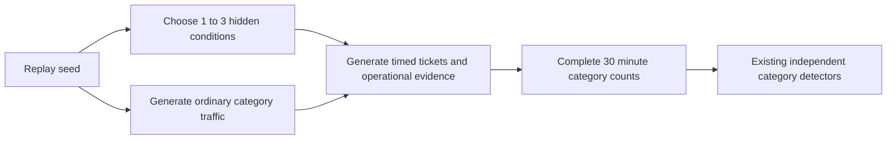
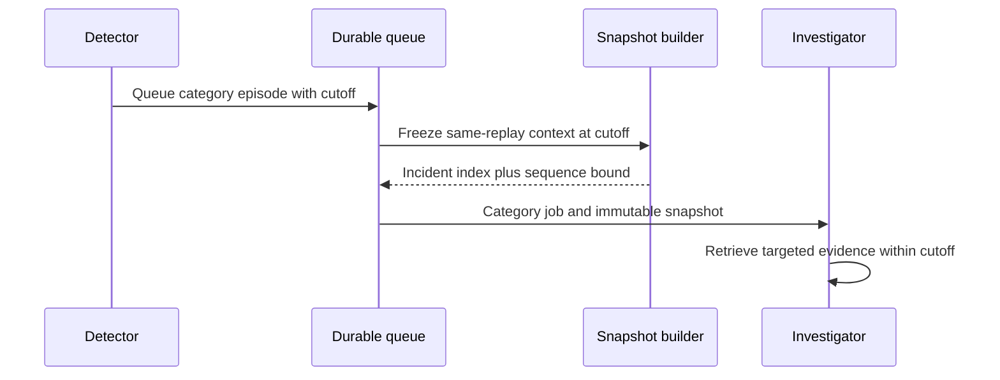
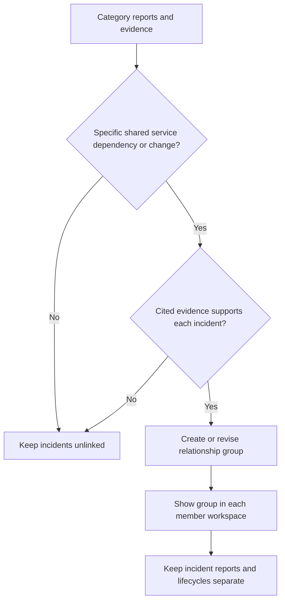
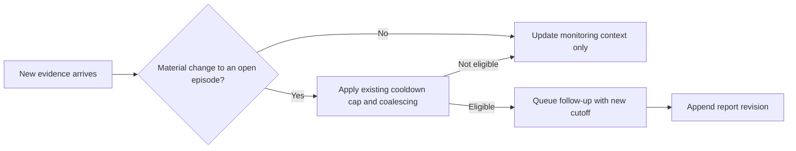
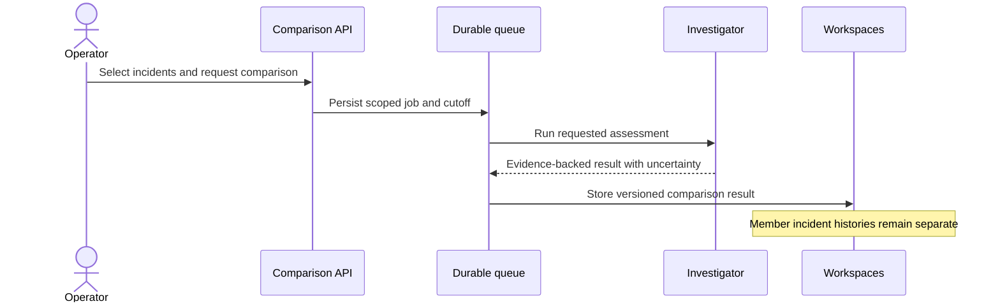

# Multi-category implementation plan

This plan implements the accepted multi-category replay and incident-context design in five reviewable stages. Each stage is developed on a short-lived branch from `feat/multi-category-demo-scenarios`, documented with its completion evidence, and merged back into that feature branch before the next stage starts. `main` and `demo` remain untouched until separately requested.

## Stage map

| Stage | Main result | Visible result |
|---|---|---|
| 1. Mixed replay | Complete | Seed selects one to three hidden conditions across categories; see `docs/results/stage-1-mixed-category-replay.md` |
| 2. Snapshot context | Complete | Each investigation freezes same-replay incident context at its evidence cutoff; see `docs/results/stage-2-cross-category-context.md` |
| 3. Relationship groups | Complete | Evidence-backed relationships are versioned independently of incidents; see `docs/results/stage-3-relationship-groups.md` |
| 4. Evidence updates | Complete | Later material evidence updates eligible open episodes under current follow-up policy; see `docs/results/stage-4-evidence-updates.md` |
| 5. Requested comparison | Complete | Operator-requested comparison is durable and separately displayed; see `docs/results/stage-5-requested-comparison.md` |

## Stage 1 - Seeded mixed-category replay

Add a mixed replay choice as the default while retaining single-category profiles as controls. The seed determines one to three hidden conditions, their timing, and category effects. Emit ordinary variation, category-specific tickets, and operational evidence. Do not expose generator truth to the detector or investigator. Keep 30-minute counts independently scored by the existing detector.

Acceptance: same seed reproduces all events and counts; counts reconcile with ticket events; more than one category can be affected; no scenario-truth labels are present in observable payloads; single-category profiles and detector configuration remain unchanged.

## Stage 2 - Immutable cross-category investigation context

When a category episode queues an investigation, freeze a compact same-replay index of other unresolved incidents known by that job's cutoff. The index is a discovery aid. Targeted retrieval remains cutoff- and sequence-bounded; later incidents cannot appear in an earlier job snapshot. Reports remain scoped to their triggering category episode.

Acceptance: queue-time context is immutable, includes only same-replay incidents known at cutoff, is isolated across runs, and cannot retrieve future events or alter other incident state.

## Stage 3 - Versioned relationship groups

Represent a supported relationship as a versioned group that references separate incidents. Require a specific shared service, dependency, or change and underlying cited evidence relevant to every group member. Timing, counts, summaries, and generic symptoms alone do not qualify. A later assessment can reaffirm, downgrade, or withdraw the relationship; no new assessment means the prior version remains visible.

Acceptance: groups are versioned and auditable, each cited relationship basis supports every member, and lifecycle actions on one incident never propagate to another.

## Stage 4 - Later evidence and existing follow-up policy

Do not enqueue work merely because alerts co-occur. When later evidence materially changes an open episode's picture, let the existing significant-evidence policy determine eligibility, cooldown, coalescing, and episode cap. Preserve every investigation revision and cutoff.

Acceptance: no extra run from co-occurrence alone, eligible evidence is coalesced, and earlier reports remain unchanged and retain their original cutoffs.

## Stage 5 - Operator-requested comparison and demo

Allow an operator to select incidents in one replay and request a separately scoped comparison through the durable investigation queue. Freeze selected scope and evidence cutoff. Present evidence, uncertainty, and possible relationships without combining incidents, replacing their reports, or changing their lifecycle. Demonstrate a supported relationship, an unrelated co-occurring alert, and a later evidence update.

Acceptance: request is durable and idempotent, scope is same-replay and frozen, result cites eligible evidence, and separate incident histories remain intact.

## Cross-stage gates

- Keep detector code, thresholds, count inputs, 30-minute windows, and per-category episode rules unchanged.
- Keep synthetic driver truth separate from observable ticket and operational evidence.
- Preserve run isolation, evidence cutoffs, sequence bounds, durable job behavior, and separate incident lifecycles.
- Add a short stage result under `docs/results/` and a UI-visible result where the stage affects operator workflows.
- Run focused backend checks and the frontend production build for changed surfaces; run the full regression suite at Stage 5.

