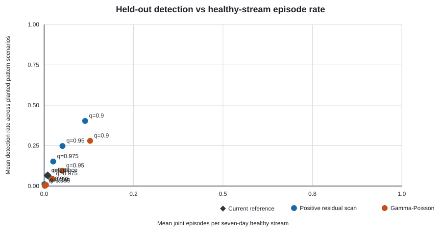
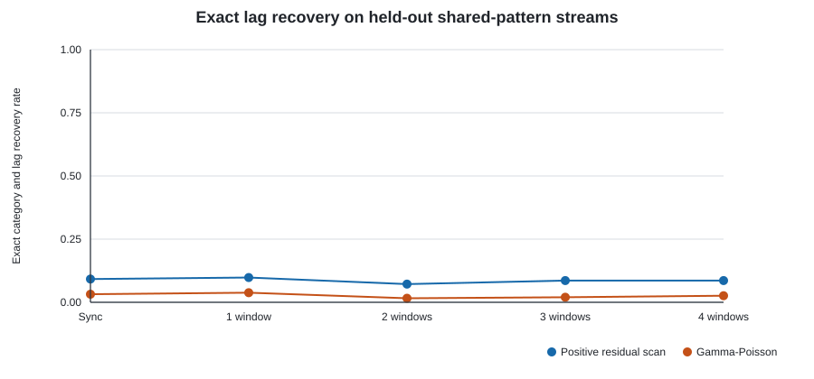

# Stage 1 — Offline statistical evaluation of multi-category counts

**Status:** Completed offline evaluation · **Replicates:** 500 per null scenario for fitting and calibration; 500 per scenario held out · **Scored horizon:** seven days (336 half-hour windows)

> This evaluates candidate count-only joint signals. It does not integrate them into the live detector, create incidents, or identify causes.

## Executive summary

This report compares the existing per-category detector as a reference with two offline candidate scores. Thresholds are calibrated from independent null streams, then evaluated on held-out streams. No candidate threshold is selected for production. Read the threshold trade-off and held-out results together; a detection rate without its healthy-stream alert rate is incomplete.

## Experiment contract

- Categories and baseline means per 30-minute window: `payments, orders, account, delivery` and `[4.5, 8.0, 4.0, 6.0]`.
- Clean fit history: 48 windows (24 h); then 336 scored windows (7 d). The planted event starts at an independent seeded position after at least 48 scored windows.
- Joint lag horizon: current completed window plus the previous 4 windows. Each lag step is 30 minutes.
- Disjoint seeds: train `0–499`, calibration `10000–10499`, held-out `20000–20499`.
- Fit data contain only healthy independent, healthy common-volume, and over-dispersed independent streams. Thresholds use only calibration null streams. The held-out partition is never used for fitting or threshold selection.
- Counts are the only candidate input. Scenario names, affected categories, onset, and lag are separate evaluator metadata and are never passed to score functions.

### Fitted null parameters

| Category | Fitted mean / window | Fitted variance |
|---|---:|---:|
| payments | 4.4994 | 7.8705 |
| orders | 8.0069 | 18.6634 |
| account | 3.9993 | 6.6943 |
| delivery | 5.9948 | 11.9890 |

Estimated shared Gamma shape: $k=9.4290$. Same-window residual correlations:

| | Payments | Orders | Account | Delivery |
|---|---:|---:|---:|---:|
| payments | 1.000 | 0.248 | 0.210 | 0.231 |
| orders | 0.248 | 1.000 | 0.242 | 0.265 |
| account | 0.210 | 0.242 | 1.000 | 0.227 |
| delivery | 0.231 | 0.265 | 0.227 | 1.000 |

## Candidate methods

For category $c$ and completed window $t$, training estimates its expected count $\hat{\mu}_c$, variance $\hat{v}_c$, and same-window residual correlation $\hat{\rho}_{cd}$. Positive standardized residuals are

$$R^+_{c,t}=\max\left(0,\frac{Y_{c,t}-\hat{\mu}_c}{\sqrt{\hat{v}_c}}\right).$$

### A. Positive residual scan

For each unordered category pair $(c,d)$, independently choose the largest positive residual in the five-window lookback. The pair score discounts expected co-movement learned from training:

$$S^{\mathrm{res}}_t=\max_{c<d}\frac{R^+_{c,t-\ell_c}+R^+_{d,t-\ell_d}}{\sqrt{2+2\hat{\rho}_{cd}}},\qquad \ell_c,\ell_d\in\{0,1,2,3,4\}.$$

The maximizing pair and its two lags are retained for offline localization metrics. The denominator is regularized below by $\sqrt{0.5}$ to avoid numerical instability. This is a positive co-exceedance scan, not a causal or general-purpose multivariate model.

### B. Shared Gamma–Poisson predictive score

For a selected pair of category-window observations, the null treats expected rates as fixed independent Poisson means. The alternative uses a shared multiplicative volume factor $G\sim\operatorname{Gamma}(k,k)$ with mean one. For pair counts $y_i$, expected means $\mu_i$, total $N=\sum_i y_i$, and $M=\sum_i\mu_i$, the log Bayes factor is:

$$S^{\mathrm{GP}}=\log\Gamma(k+N)-\log\Gamma(k)+k\log k-(k+N)\log(k+M)+M.$$

The score is truncated at zero and maximized across category pairs and the 0–4 window lag choices. $k$ is estimated from training stream totals and bounded to $[0.5,100]$. A larger $k$ approaches a fixed shared rate; smaller $k$ permits more common-volume variation. This model tests a shared multiplicative count fluctuation; it does not imply a shared operational cause.

### Reference: current per-category detectors

The existing negative-binomial category detector and its checked-in calibrated thresholds are run unchanged. The reference joint flag is at least two distinct category alerts within the same five-window lookback. This post-processing is solely an evaluation comparator; it does not change or combine live alerts.

## Scenario matrix

| Scenario | Planted count pattern | What it checks |
|---|---|---|
| Healthy independent | No planted change; independent Poisson | Nominal null behavior |
| Healthy common volume | No fault; shared mean-one Gamma volume factor | Normal correlated volume should not be mistaken automatically for a fault |
| Shared synchronous | Payments and Account elevated together | Same-window detection and localization |
| Shared delayed 1–4 | Payments pulse, Account pulse after 1–4 windows | Lag search and lag localization |
| Independent simultaneous / delayed | Similar marginals, distinct planted pulses | Detect unusual joint patterns without claiming shared cause |
| Single category | Payments alone elevated | Joint signal should not be the only route for univariate alerts |
| Beyond horizon | Second category begins 7 windows later; first pulse lasts 3 windows | Expected miss outside the declared search horizon, including pulse persistence |
| Over-dispersed independent | Independent Gamma–Poisson category rates | Robustness to marginal over-dispersion |

Each event pulse multiplies its category rate by 3.6 for three windows. These are controlled synthetic fixtures, not estimates of production incident prevalence.

## Held-out results

The table gives the center of the predeclared threshold sweep (97.5th percentile of calibration-stream maximum scores). It is a comparison slice, not a recommended operating threshold. For planted patterns, the rate is the proportion detected at or after the earliest planted effect; for healthy scenarios, it is the proportion of full streams with at least one false joint signal. Rates have 95% Wilson intervals over independent held-out seeds. Episode counts are means with seed-level bootstrap 95% intervals.

| Candidate | Scenario | Detection / false-alarm stream rate (95% CI) | Episodes / stream (95% CI) | Mean delay (windows, planted only) | Contributor recall | Exact lag |
|---|---|---:|---:|---:|---:|---:|
| positive_residual_scan | healthy_independent | 0.000 (0.000–0.008) | 0.000 (0.000–0.000) | — | — | — |
| positive_residual_scan | healthy_common_volume | 0.064 (0.046–0.089) | 0.066 (0.044–0.090) | — | — | — |
| positive_residual_scan | shared_sync | 0.184 (0.152–0.220) | 0.184 (0.150–0.220) | 1.261 | 0.184 | 0.092 |
| positive_residual_scan | shared_delay_1 | 0.216 (0.182–0.254) | 0.216 (0.180–0.254) | 1.963 | 0.216 | 0.098 |
| positive_residual_scan | shared_delay_2 | 0.206 (0.173–0.244) | 0.206 (0.170–0.242) | 2.786 | 0.206 | 0.072 |
| positive_residual_scan | shared_delay_3 | 0.204 (0.171–0.242) | 0.204 (0.168–0.242) | 3.696 | 0.204 | 0.086 |
| positive_residual_scan | shared_delay_4 | 0.166 (0.136–0.201) | 0.166 (0.134–0.198) | 4.602 | 0.166 | 0.086 |
| positive_residual_scan | independent_simultaneous | 0.184 (0.152–0.220) | 0.184 (0.150–0.220) | 1.261 | 0.184 | 0.092 |
| positive_residual_scan | independent_delayed | 0.206 (0.173–0.244) | 0.206 (0.170–0.242) | 2.786 | 0.206 | 0.072 |
| positive_residual_scan | single_category | 0.000 (0.000–0.008) | 0.000 (0.000–0.000) | — | 0.000 | 0.000 |
| positive_residual_scan | beyond_horizon | 0.000 (0.000–0.008) | 0.000 (0.000–0.000) | — | 0.000 | 0.000 |
| positive_residual_scan | overdispersed_independent | 0.010 (0.004–0.023) | 0.010 (0.002–0.020) | — | — | — |
| shared_gamma_poisson | healthy_independent | 0.000 (0.000–0.008) | 0.000 (0.000–0.000) | — | — | — |
| shared_gamma_poisson | healthy_common_volume | 0.062 (0.044–0.087) | 0.062 (0.042–0.086) | — | — | — |
| shared_gamma_poisson | shared_sync | 0.062 (0.044–0.087) | 0.062 (0.042–0.084) | 1.290 | 0.062 | 0.032 |
| shared_gamma_poisson | shared_delay_1 | 0.076 (0.056–0.103) | 0.076 (0.052–0.100) | 2.000 | 0.076 | 0.038 |
| shared_gamma_poisson | shared_delay_2 | 0.056 (0.039–0.080) | 0.056 (0.036–0.076) | 2.679 | 0.056 | 0.016 |
| shared_gamma_poisson | shared_delay_3 | 0.054 (0.037–0.077) | 0.054 (0.034–0.074) | 3.667 | 0.054 | 0.020 |
| shared_gamma_poisson | shared_delay_4 | 0.044 (0.029–0.066) | 0.044 (0.026–0.062) | 4.455 | 0.044 | 0.026 |
| shared_gamma_poisson | independent_simultaneous | 0.062 (0.044–0.087) | 0.062 (0.042–0.084) | 1.290 | 0.062 | 0.032 |
| shared_gamma_poisson | independent_delayed | 0.056 (0.039–0.080) | 0.056 (0.036–0.076) | 2.679 | 0.056 | 0.016 |
| shared_gamma_poisson | single_category | 0.000 (0.000–0.008) | 0.000 (0.000–0.000) | — | 0.000 | 0.000 |
| shared_gamma_poisson | beyond_horizon | 0.000 (0.000–0.008) | 0.000 (0.000–0.000) | — | 0.000 | 0.000 |
| shared_gamma_poisson | overdispersed_independent | 0.006 (0.002–0.017) | 0.006 (0.000–0.014) | — | — | — |

### Calibrated threshold sweep

Threshold values are the calibration-partition quantiles of the per-stream maximum score over the full seven-day stream.

| Candidate | Calibration max quantile | Threshold |
|---|---:|---:|
| positive_residual_scan | 0.900 | 6.710838 |
| positive_residual_scan | 0.950 | 7.269817 |
| positive_residual_scan | 0.975 | 7.734535 |
| positive_residual_scan | 0.990 | 8.291055 |
| positive_residual_scan | 0.995 | 9.247232 |
| shared_gamma_poisson | 0.900 | 8.206595 |
| shared_gamma_poisson | 0.950 | 11.343811 |
| shared_gamma_poisson | 0.975 | 14.529029 |
| shared_gamma_poisson | 0.990 | 18.841781 |
| shared_gamma_poisson | 0.995 | 23.491303 |

### Existing detector reference

| Scenario | Detection / false-alarm stream rate (95% CI) | Joint episodes / stream (95% CI) | Mean delay (planted only) |
|---|---:|---:|---:|
| healthy_independent | 0.000 (0.000–0.008) | 0.000 (0.000–0.000) | — |
| healthy_common_volume | 0.016 (0.008–0.031) | 0.026 (0.008–0.052) | — |
| shared_sync | 0.074 (0.054–0.100) | 0.074 (0.052–0.096) | 1.189 |
| shared_delay_1 | 0.100 (0.077–0.129) | 0.100 (0.076–0.128) | 2.300 |
| shared_delay_2 | 0.096 (0.073–0.125) | 0.098 (0.072–0.124) | 2.646 |
| shared_delay_3 | 0.080 (0.059–0.107) | 0.080 (0.058–0.104) | 3.700 |
| shared_delay_4 | 0.072 (0.052–0.098) | 0.072 (0.050–0.094) | 4.417 |
| independent_simultaneous | 0.074 (0.054–0.100) | 0.074 (0.052–0.096) | 1.189 |
| independent_delayed | 0.096 (0.073–0.125) | 0.098 (0.072–0.124) | 2.646 |
| single_category | 0.000 (0.000–0.008) | 0.000 (0.000–0.000) | — |
| beyond_horizon | 0.002 (0.000–0.011) | 0.002 (0.000–0.006) | 9.000 |
| overdispersed_independent | 0.004 (0.001–0.014) | 0.004 (0.000–0.010) | — |

### What these results say

- At this calibrated threshold slice, the residual scan detects 18.4% of synchronous planted patterns and produces at least one false signal in 6.4% of healthy common-volume streams. The shared Gamma–Poisson score is 6.2% and 6.2%, respectively. These are modest hit rates; the Gamma–Poisson candidate barely separates this planted pattern from normal common-volume movement.
- The existing per-category reference detects 7.4% of synchronous patterns with 1.6% of healthy common-volume streams falsely signaling under the same five-window category-alert aggregation. It has lower sensitivity here, but also a lower common-volume false-alarm rate than either candidate.
- The residual scan detects 16.6% of the shared four-window delayed patterns at this threshold. Mean detection delays and end-to-end lag localization are shown in the table; the 30-minute sampling interval limits timing precision.
- Single-category and beyond-horizon patterns should not yield joint signals; the measured rates are reported in the table. Existing per-category detection remains the path for a one-category issue.
- The independent-simultaneous fixture deliberately has the same observed count distribution as the shared-synchronous fixture. Their equal scores demonstrate the boundary: counts can show an unusual joint pattern, but cannot tell us whether the underlying events share a cause.
- These results do not justify promoting either score to the live detector. A later stage should first review and, if needed, revise the controlled scenario assumptions or compare additional calibrated candidates; no production false-alert budget was supplied.


## Threshold sensitivity and localization





The trade-off chart averages detection across nine planted scenarios and mean episode counts across three healthy scenarios. It is descriptive; the scenario mix is artificial and no deployment operating point follows from this average. Exact lag recovery is evaluated only for the two-category shared patterns; every threshold quantile is retained in the JSON companion.

## Uncertainty and interpretation

Held-out planted-detection and healthy-stream false-alarm rates use Wilson 95% intervals. Mean episode counts and mean detection delay use percentile bootstrap 95% intervals resampling independent seeds (1,000 draws; fixed bootstrap seed 943). Contributor recall and exact-lag rates are end-to-end: a missed signal contributes zero. These intervals describe Monte Carlo uncertainty under these generators, not uncertainty about real-world performance. The five thresholds are fixed from calibration maxima and held constant across all held-out scenarios.

Statistical association is not causal attribution. Independent simultaneous or delayed events may trigger a joint statistical pattern if their vector is rare. The later RCA stage must use separate, evidence-grounded reasoning to assess shared cause, separate causes, or uncertainty.

## Reproduction

From the repository root, run:

```powershell
uv run python -m agentic_ops.evaluation.joint_count_eval --seeds-per-partition 500
uv run python scripts/render_joint_count_results.py
uv run pytest tests/test_joint_count_eval.py -q
```

The first command writes the machine-readable benchmark results beside this report. `--quick` runs a 12-seed smoke check and must not be cited as performance evidence. The generated SVGs are self-contained and require no charting dependency.

## Limits and Stage 1 disposition

- The fixture uses four fixed categories and stationary baseline means; seasonality, weekday effects, missing windows, changing ticket mix, and category definition drift are not modeled.
- Same-window training correlation is used by the residual candidate; delayed dependence is searched over 0–4 lags but is not explicitly learned as a lag-specific null covariance.
- The Gamma–Poisson alternative is a shared-rate fluctuation model, not a full learned joint distribution.
- No synthetic labels reach scoring, but generator design still determines what patterns are represented.
- No production threshold, alert budget, application wiring, agent tool, queue behavior, or UI is delivered in Stage 1.
- Stage 1 is complete as an offline measurement artifact. Candidate promotion requires review of the held-out trade-offs and a later design decision.
